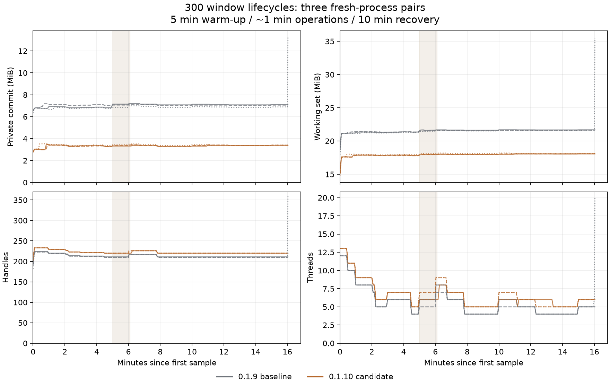
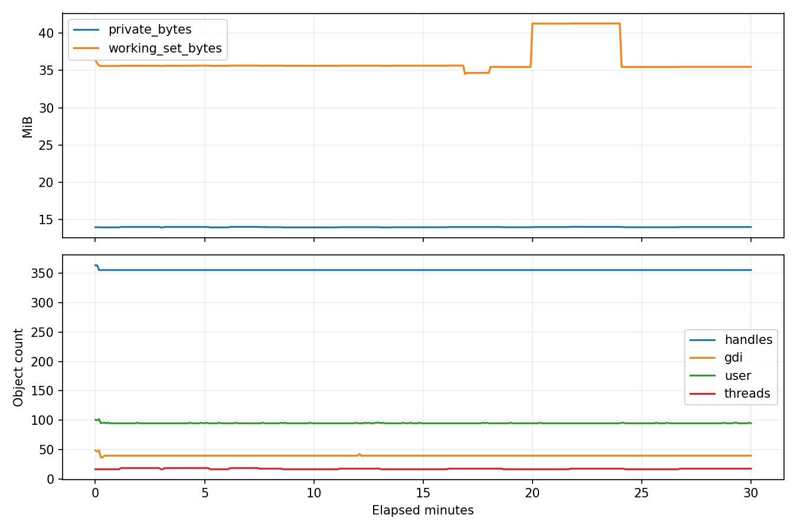

# 0.1.10 开发阶段验收记录（归档）

保留阶段性结果与当时待办，不代表当前发布状态；最新见[正式验收记录](../validation_0_1_10.md)。

# 0.1.10 开发验收摘要

当前验收范围已调整：完整功能 release 层为本次发布门槛；多场景三轮及 2h/8h 为独立扩展资源认证，尚未完成，不声称已通过。下文早期“资源门槛后才发布”的记录保留为历史进度，当前以 [当前计划](plan_0_1_10.md#验收范围调整2026-10-16当前有效) 为准。

0.1.10 CI 候选已冻结，窗口三轮对照已完成，完整功能发布层正在执行；当前不代表已发布或完整验收。公开版仍为 0.1.9。下文保留不同开发阶段的原始结论与限制，当前准确资产及未完成门槛见末尾。范围见[计划](plan_0_1_10.md)及[资源审计](../resources_0_1_10.md)。原始实验文件不进入版本库。

## 本轮优化构建与组件验证

完整发布层已通过格式、严格 Clippy、脚本控制流检查，以及优化构建 `cargo test --all --release`：303 通过、0 失败、7 ignored。ignored 项含原生 fixture 和资源实验，需专项执行，不计入这 303 项。实际产品功能与历史更新组仍在执行，不能据此宣布完整验收。

本轮在优化版独立测试可执行文件中重复的组件实验：

- 停滞源的 DWM 注册/释放及 owned 路径图标淘汰寿命通过；三个新进程各验证 32 个隐藏窗口/1000 次请求，单 worker 合并请求和结果，释放后私有提交增量未观察到残留。这不是所有图标源/文件 I/O 的硬实时保证。
- 日志队列两种容量各三个新进程：128000 槽私有提交增量中位数 4136960 字节，512 槽为 28672 字节，组件差值 4108288 字节（约 3.92 MiB）。这是队列实验，不是整应用占用差值。
- 32 MiB 合成文件的暂存对照，各三个新进程：旧双缓冲峰值增量中位数 67248128 字节（约 64.13 MiB）；流式模式未观察到 Private Bytes 峰值增量。后者不代表零分配，不包含网络、真实外壳或交接；不能宣称产品所有更新场景减少相同数值。

## 完成的窗口资源对照

准确 CI 候选与公开 0.1.9 在同一 Windows build 20348、1680×1050、96 DPI 主屏、普通用户 companion 模式对照。English、Auto 主题、底部任务条，菜单/预览关闭；每轮全新进程，先后顺序交替，共三组（六个进程）。每进程预热 5 分钟，创建/销毁 300 个测试窗口（最多同时 8 个，约 62 秒），随后静置回收 10 分钟；实际每次约 962 秒、196 个采样点，默认 5 秒及阶段/操作检查点。原始 CSV、摘要、进程创建身份、阶段覆盖与回收增长检查逐进程通过，结束恢复原程序/工作区/登录 Shell。

下表为“每进程回收阶段中位数，再对三次取中位数”，内存按 MiB（1048576 字节）。

| 指标 | 0.1.9 基线 | 0.1.10 候选 |
|---|---:|---:|
| 私有提交 Private Bytes | 7.06 MiB | 3.38 MiB |
| 工作集 Working Set（含共享页） | 21.61 MiB | 18.07 MiB |
| 句柄 | 210 | 220 |
| GDI 对象 | 15 | 33 |
| USER 对象 | 72 | 79 |
| 线程 | 5 | 6 |

灰色为 0.1.9，棕色为准确候选，三种线型为三次独立运行，浅色区域为窗口操作期。保留全部实际采样；第三次基线末尾存在短时峰值（私有提交约 13.30 MiB、工作集约 35.52 MiB），未单独归因，不删点，也不以该峰值推导优化比例。候选各次私有提交峰值约 3.47–3.53 MiB。

这组结果说明所测窗口场景的私有提交与工作集较低，**不代表所有资源都下降**：候选句柄、GDI/USER 和线程的回收中位数更高。owned 图标与固定 worker 的设计引入显式资源所有权，但本实验没有逐项归因全部差值；GDI/共享内存也不能全部折算为进程 Private Bytes。回收首尾私有提交差值在约 ±40 KiB，短期波动不等于长期泄漏结论。系统不支持的 Private Working Set 留空，未冒充为零。

这是一个约 16 分钟/进程的有限窗口场景，不能推广为日常固定占用、全场景改善、数小时稳定或零泄漏。空闲/设置的整应用三轮及独立 2h/8h 尚未完成，按当前计划独立跟踪。观察器开销单列，不计作产品优化。组件实验仍单独说明范围。

候选 SHA-256：`8242af01de8822a1de7f0b8c57f182831a892eb491c9e785406bce63d8feb6a6`；基线 SHA-256：`2f4b9d03ea9309a74fc9afe5dfc89bf78d5ed4b991b264c9aec0423f3cb5ff6c`。图中仅有审阅后的资源数值，无工作路径或用户内容。

## 早期开发验证（历史阶段）

- 第一轮单元测试 273 项通过，3 项需要独立 native 资源环境的实验分开执行；本轮按模块运行配置 33 项、设置存储 8 项、日志 6 项，均通过；严格 Clippy 通过。
- 资源实验：停滞源窗口的 DWM 缩略图 100 次注册/释放完成；缓存清除后持有快照的路径图标仍有效，最后一个引用释放后句柄失效。
- 日志队列容量对照：每种容量各运行 3 个全新进程，debug 与优化构建分别验证。128,000 槽位与 512 槽位的私有提交增量中位数差值均为 4,108,288 字节（约 3.92 MiB）。只归因到队列创建路径，不作为整个应用的内存优化比例。
- 左右侧边任务栏 15 项实机检查通过：默认宽度、左右拖动方向、拖动预览、提交保存、取消与 Esc、最小/最大宽度、工作区更新、重启持久化，以及结束后不遗留 Esc 注册。退出恢复工作区，正常会话恢复原公开二进制与配置，Shell 注册未变。
- 故障层通过：快捷启动文件超长、非法编码、替换前失败、外部修改和真实占用时保留文件；交接清单 16 KiB 读取边界；本地 HTTP 大小/错误状态与哈希/URL 校验。
- Python 采样与导出验证 7 项通过：真实进程指标、退出停止、统计口径、输入预算及公开字段白名单。未知字段不导出，数值字段中的路径字符串被拒绝。

本轮补充：

- 用户偏好默认写入 `~/winmgr.cnf`；两个独立进程分别调用实际设置入口并异步保存、再重新加载，九项偏好全部恢复，不指定 `MINICON_SETTINGS`。迁移测试覆盖旧偏好和注释保留、原文件不改写、失败/非法编码/超长输入拒绝覆盖。
- 日志增加 16 KiB 格式化记录边界与固定四文件、各 8 MiB 的磁盘预算；真实事件验证中文/emoji 截断后 UTF-8 有效且后续日志仍可用。真实文件测试覆盖重启轮换、两个独立 writer 并发、锁冲突和文件系统拒绝。旧 daily 日志不自动清理。
- 扩展侧栏实机脚本以验证用户目录与无参数重启；本轮两次尝试分别在工作区时序及真实指针拖动断言未通过，不能当作新路径的实机通过证据。两次均恢复原公开二进制与正常会话，最后一次退出工作区恢复通过；九项偏好恢复以独立进程测试为证。实机整套重跑仍待进行，既有 15 项记录仅代表第一轮构建。

## 图标查询隔离专项

一个固定 worker、32 个同一测试进程创建的隐藏窗口，单个源线程停在 WM_GETICON 处理内；向实际请求入口连续提交 1000 次，再从最新快照移除一个目标，验证过期结果不能带回它。debug 与优化构建分别在三个全新进程重复，通知也只保留一个未消费消息；完成结果只补画图标，不触发新的整轮查询。33 项任务栏布局/分组单测与严格 Clippy 通过。正常桌面、二进制和偏好均未替换，也未发送鼠标输入。

| 三次实验中位数 | debug | 优化构建 |
|---|---:|---:|
| 1000 次请求提交耗时 | 35 ms | 3 ms |
| 最后一次提交至完成最新批次（31 个目标） | 78 ms | 81 ms |
| 原生旧调用模式：5 个窗口 × 3 次 50ms 等待 | 758 ms | 757 ms |
| worker 与 32 个拥有图像就绪后的私有提交增量 | 48 KiB | 44 KiB |

旧调用模式在测试线程复现，不运行在用户外壳；它与新路径的窗口数不同，不能换算为整机性能百分比。查询/复制的新增成本必须纳入后续全应用对照，这个 Private Bytes 观察也不能代表整个 Windows 图形资源开销。debug 和优化构建结束时的私有提交相对起点均为 0；GDI 差值均 −6、USER 均 −3。结束样本还包含原图标销毁及一个源窗口关闭，负差值不能归为优化成果。这些是短测事实，不承诺长期无泄漏。

所有权专项用真实 GetIconInfo 验证复制句柄与来源句柄不同、尺寸确为 32×32、来源图标明确销毁及源窗口关闭后仍有效、最后一个引用释放后失效；检查产生的位图均释放。过期请求、缓存清空、停止 worker、通知合并，以及目标未变时查询失败保留上次有效快照一起验证。跨进程来源、更多实际应用、任务栏可视表现与整机小时级场景仍待进行。

## 更新流式暂存专项

新旧文件各为 32 MiB 的 PE 形状测试数据，不执行。每种模式各三个全新进程，分别在 debug / 优化构建重复；预热 CNG，两个模式均带同样的 1ms 观察线程。对照重现此前同时持有新 payload 和旧 exe 两个完整缓冲的模式；流式组调用实际 prepare 路径、文件校验及 helper 复制，并复核原文件未改变。

| 私有提交峰值相对预热基线的增量（三次中位数） | debug | 优化构建 |
|---|---:|---:|
| 旧双整文件缓冲模式 | 67,252,224 字节 | 67,248,128 字节 |
| 实际流式准备 | 8,192 字节 | 未观察到增量 |
| 差值 | 67,244,032 字节（约 64.13 MiB） | 67,248,128 字节（约 64.13 MiB） |

这是准备组件的 Private Bytes 对照，排除网络、TLS、真实外壳与交接。观察不到增量不代表零分配、零资源或系统总内存成本为零；固定缓冲可以复用已提交页，1ms 采样也有分辨率限制。不把这组数据推广为整个应用的优化比例或长跑结论。

更新相关 12 项普通测试通过（协议/版本 3、HTTP 3、安装 4、流式哈希 2）；独立故障层另验证 pin 文件保护。覆盖已知/未知长度、截断/超限响应、消费方失败与预算超限、增量哈希已知向量、只读到上限 + 一个探测字节、来源读取及写入失败、暂存失败清理、旧文件占用、PE 架构和哈希错误。严格 Clippy 与构建通过。

真实 update 层 15 项检查通过，包括手动联网、失败重试、校验错误不改当前文件、下载与重启分离、保存失败禁止重启、交接前重验、两个版本的实际交接、配置保留、占用恢复、未回执候选回滚。fixture 为当前代码回移到上一补丁版本，目标为当前开发二进制（当前 Cargo 仍暂保留 0.1.9）；不是历史公开版对照。测试恢复原 live 文件并检查摘要、正常会话和 Shell 注册均恢复。验收脚本同步修正原二进制恢复与 UTF-8 错误记录，原始报告与截图留在 target。

仍需实际网络条件下的峰值、慢响应/低磁盘等扩样，以及 0.1.10 候选的全应用场景和小时级门槛。

## 公开 0.1.9 的 30 分钟观察

同一正常运行实例，5 秒间隔，共 361 个样本，实际时长 1800.032 秒，正常结束。二进制摘要与[公开附件](../validation.md)相同。此为日常会话观察，期间存在开发工具及正常桌面活动，不能当作三次受控空闲实验。

| 指标 | 中位数 | P95 | 首尾窗口差值 |
|---|---:|---:|---:|
| 私有提交 | 14.01 MiB | 14.03 MiB | −8 KiB |
| 工作集 | 35.63 MiB | 41.29 MiB | −148 KiB |
| 句柄 | 355 | 355 | 0 |
| GDI 对象 | 40 | 40 | 0 |
| USER 对象 | 95 | 96 | 0 |
| 线程 | 18 | 19 | −1 |

图中工作集波动与私有提交走势不同。不能仅根据工作集涨跌认定泄漏，也不能把本次短时观察推广为长期无泄漏。该系统未使用 EX2，Private Working Set 明确缺失，不冒充为零或 Private Bytes。

## 未完成

仍需受控场景三次重复及整个应用优化前后对照、真实预览与慢路径扩样、更多 worker/网络故障、诊断整体资源对照、2 小时及至少 8 小时观察、发布长跑门禁和完整 release 验收。物理混合 DPI、多屏热插拔等环境另列，当前侧边几何单测不能替代这些实屏结果。

## 按需诊断专项（开发）

5 项数据与导出测试通过：缺失值与真实零的区分、分位数及首尾口径、倒退时间与容量/时长上限、停止后释放数组并保持摘要、慢写入期间拒绝叠加任务、失败/取消/实际文件占用时保留旧目标并清理本次临时文件。

原生专项从真实“关于”按钮进入诊断窗口，四个全新测试子进程覆盖 En/Zh × light/dark，共 79 项通过。检查默认未采样/未创建导出线程、真实 5 秒采样、停止撤销定时器和拒绝迟到消息、保存取消和实际保存、固定字段无工作目录、关闭/重开保留停止摘要、新记录默认否、场景恢复，以及窄/宽窗口控件边界。正常 live 二进制摘要和 Shell 注册保持不变。严格 Clippy 与格式检查通过。

这是独立原生窗口 fixture 的验收，内存数值不能用作完整 winmgr 的新基线；合成时长上限不替代真实 8 小时长跑。截图和原始报告只留在忽略目录。

## 默认日志隐私（开发）

统一字段格式器屏蔽字符串、Debug/Display 和错误链，不因 trace 级别而放开；panic 输出屏蔽载荷及源路径。4 项 logging 测试通过：UTF-8/长度及后继事件、饱和队列不阻塞、静态事件文案的源码 AST 检查，以及实际子进程的文件/stderr/span/panic 隐私边界。子进程启用 trace 和完整 backtrace，使用合成敏感标记及一旦格式化就 panic 的字段，验证标记未输出、格式化未执行，并保留操作成败说明和数值。临时文件在本轮自建系统临时目录，测试结束清理；不使用用户的日志目录。

审计覆盖当前 src 中的 tracing 调用和 panic 输出；显式 CLI 查询打印与用户主动查看的错误对话框另属交互结果。既有历史日志不做自动清除，不能把新输出保护宣称为历史数据已清理。

## 更新请求的慢响应及失败恢复（开发）

更新相关 16 项普通测试通过（版本/协议/worker 4，HTTP 6，安装 4，流式哈希 2）；测试过滤还命中另两项现有 tray 更新测试，不能混计为新增更新覆盖。新的 loopback 场景包括完全不返回响应头、逐字节响应头、响应头后正文停滞、逐字节正文和断流，每次失败后新的请求均能成功。

慢响应测试使用 300ms 预算及 3 秒失败检测上限，不将检测上限作为产品响应承诺。同步方案在静默响应头测试中约等待 4 秒才因服务器关闭而结束；原生异步方案的完整 HTTP 六项专项总计约 1.25 秒。实际 context 的 Weak 引用确认取消后的状态/16 KiB 缓冲释放，并在关闭测试服务器前检查；消费端 panic 同样释放。零预算不连接、不调用消费端。更新 worker panic 且进度通道已满时，界面状态读取不等待 worker，随后 poll 能转为失败，再次操作可成功。

这些结果来自独立测试进程和 loopback，未替换正常 live 外壳；不涵盖公网 DNS、代理/TLS、任意文件 I/O 的硬超时，也不能代替完整更新交接和整应用资源/长期验收。

本轮 fault 层共 14 项通过（pin 1、安装 4、HTTP 6、worker 故障 1、流式哈希 2），另一个组件内存实验按设计保持忽略，必须单独运行。quality（格式、严格 Clippy、日志边界）通过。CI 同步加入这个不需要交互桌面的 fault 层，不把桌面更新交接混入开发期默认检查。

## 场景驱动与当前执行边界

整应用驱动的 10 项生命周期测试通过，使用模拟进程验证控制流，不修改真实桌面。另有现有采样/摘要 7 项测试通过。早期真实 smoke 在输入桌面预检处拒绝执行，未进入关闭原实例的路径；随后桌面恢复后的结果见文末。公开 0.1.9 exe 摘要为 `2f4b9d03ea9309a74fc9afe5dfc89bf78d5ed4b991b264c9aec0423f3cb5ff6c`。

尚无正式资源 campaign 结果，因此不发布内存优化百分比，不宣称整应用三次基线、200/300 次循环或 2 小时/8 小时通过。短测与真实恢复已开始验证，资源验收须另按规定时长/操作规模执行。

## 更新退出取消与进度合并

新增每次操作的取消标记，程序退出先断开更新状态与接收。验证真实 worker 等待静默服务器时，shutdown 本身在测试的 100ms 检测线内返回；worker 在 2 秒检测线内结束，服务器保持连接直到检查结束。检测线是测试报警值，不是产品硬实时承诺。HTTP 单独验证已有响应头/尚无响应头时取消，以及取消后原生 context/16 KiB 缓冲释放。

100,000 次进度写入只保留最新值，终态使用独占单槽非阻塞投递；在没有 UI poll 的情况下，worker 持有的取消 token 引用释放，随后 poll 仍读取到最终字节数和终态。反复 shutdown 安全，退出后拒绝新任务。暂存在 7 个步骤边界各注入取消，均保留原程序内容并移除本次生成的固定文件。

当前普通更新测试共 20 项（状态/协议 6、HTTP 7、安装 5、流式哈希 2）。这组检查不声称已取消任意同步文件 I/O，不代替真实窗口恢复、更新助手交接及 2 小时/8 小时验收。

本轮 fault 层 21 项通过（pin 1、更新状态/协议 6、HTTP 7、安装 5、流式哈希 2），quality 的格式、严格 Clippy、日志边界及 10 项场景驱动模拟检查通过。该阶段输入桌面不可访问，后续恢复后的原生结果如下。

## 输入桌面恢复后的短测与新增缺陷

- 四边工作区与真实最大化边界八次切换通过，第二组旧版残留工作区回归也通过；侧栏拖宽、取消与偏好重启恢复共 16 项通过。
- 设置与完整 Run 原生回归 35 项通过，包含桌面切换确认框 Esc 取消修复。中英文时钟弹窗入口均实际打开回收站命名空间，未操作回收站内容；键盘与主题完整矩阵仍待验收。
- 跨版本手动启动使用官方 0.1.4 和公开 0.1.9 作为旧实例：英文/中文默认取消、Esc 保留原进程、确认后正常退出并由候选就绪、同构建重复启动复用均通过。两组各 13 项通过（共 26 项），每组结束恢复原程序、工作区与 Shell 登记。启动故障回退为尽力恢复，尚未做故障注入，不承诺异常终止的恢复。
- 资源门槛校验器的 13 项合成数据测试通过，不是资源优化证据。上述原生短测不是正式资源 campaign，完整对照与 2h/8h 仍未完成。

## 候选冻结前的补充回归

开发优化构建通过日常交互 44、布局 16、主题/停靠 27、真实更新交接 15 项。诊断实际“关于 → 诊断”入口与预览共 27 项：中英/明暗四组记录控制、默认不替换旧记录、关闭、真实合成源画面、鼠标移出隐藏、最小化后界面仍响应及源销毁清理。回收站中英/明暗 × Enter/Space 八组组合经原生 Tab 到达按钮，均验证真实回收站命名空间打开；不涉及其内容。

`cargo test --all --release`：303 通过、7 ignored；ignored 的 fixture/资源实验需要专项执行，不计入通过数。此前诊断 fixture 79 项是独立测试窗口，新增 27 项才是实际程序入口与预览。所有桌面组由外层恢复原程序、工作区及 Shell。以上使用冻结前开发文件，0.1.10 CI 准确资产需重新验收；正式资源对照、2h/8h 仍待执行。

## 0.1.10 CI 准确资产（执行中）

[候选构建](https://github.com/partnernetsoftware/minicon-winmgr/actions/runs/38901243313) 已成功，下载文件摘要 `8242af01de8822a1de7f0b8c57f182831a892eb491c9e785406bce63d8feb6a6`。同一文件实际诊断与预览 27 项通过；首次第四组截图的 PrintWindow 失败仍留存本地，外层正常恢复。探针现在先重绘并等画面更新，补充错误上下文，不在失败后循环截图直到成功。

正式资源采样已经开始窗口场景首轮基线。尚无完成的三轮场景/2h/8h，也未运行通过新的完整发布层；不发布资源优化百分比，不视为发布验收完成。公共构建清单与最终发布摘要需在全部证据审阅后生成。

首个正式窗口基线的原始 CSV 检查已通过：300 创建/300 销毁、196 样本，满足 5 分钟预热与 10 分钟回收，独立摘要与实际采样一致。第一轮候选进程已开始；尚未形成三轮整体对照，不据此发布资源改善数字。

首组窗口基线/候选已分别通过 CSV、独立摘要、样本覆盖、阶段时长及回收增长检查：均为 300 创建/300 销毁、196 样本，两个新进程身份不同、观察时间不重叠。第二组已开始。此为一组场景证据，不是三轮汇总或长期稳定性结论。

前两组窗口对照现均通过逐进程原始数据检查：四个已结束的进程各完成 300 创建/300 销毁、196 样本，预热与回收时长满足门槛；第三组已开始。三组汇总、其他场景及独立长跑仍未完成。
