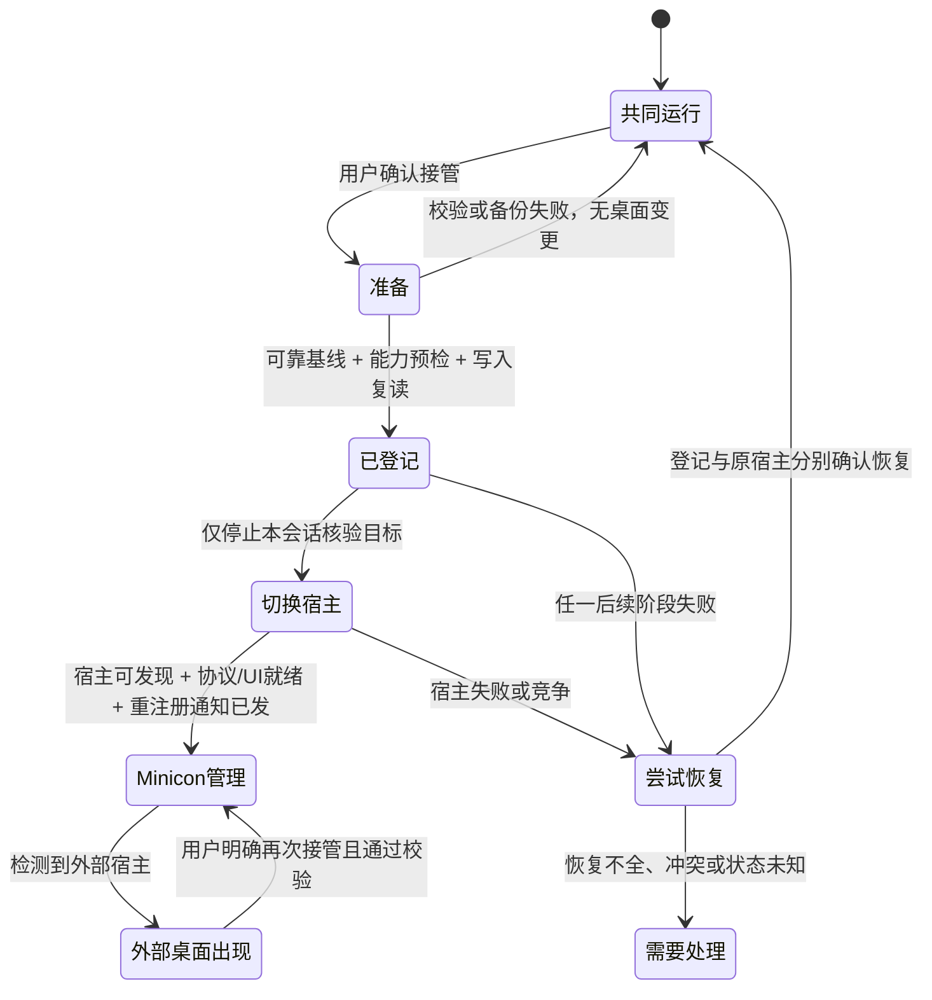

# 0.1.12 产品设计讨论稿：桌面交接有结果，失败后有退路

> 产品收口（2026-10-18）：用户认为当前能力基本够用，项目以完成 0.1.x 基础能力、修复可靠性问题为主，不默认扩展新功能或 macOS 产品。本稿保留完整失败边界供选择修复方案参考，不代表所有新流程必须实施。复杂旧记录导入、多会话长期所有者管理、新的恢复界面等建议需按实际缺陷决定是否必要；不能只因设计已写出就成为发布门槛。选定修复仍须完整验证其成功、失败与恢复路径。

状态：**完整设计参考；本版选定实施范围以版本计划为准**。日期：2026-10-18。依据：[版本计划](plan_0_1_12.md)与[代码审阅](review_0_1_12.md)的 C01/C02/C03/C06/C07/C09，以及实际 `shell_swap`、`shell_registry`、`window`、`instance_switch`、`tray_host`、`settings_ui` 调用链。本文不改变 0.1.11 的发布范围，不改 Run 已暂时接受的交互。

这是拟回写 [Shell 规格](prd_3_1.md)、[可靠性规格](prd_2_1.md)、[通知区规格](prd_1_1_2.md)与[设置规格](prd_6_1_1.md)的行为设计；整合时不另建一份与 PRD 长期并行的规格。旧试替换记录仍作为历史保留，不能当作本设计的验收。

## 1. 本版给用户带来的变化

用户选择 Minicon 管理桌面时，应该知道三件事：**现在是谁在管理桌面，下次登录会使用什么，出现问题能否恢复**。不要求用户理解通知窗口类、回执文件或注册表。

本版不靠增加常驻按钮体现价值。沿用设置中的接管与恢复入口，补足状态、确认和结果，使用户不再收到“接管成功”后托盘不可用、或“立即还原”后当前桌面没有变化的提示。

| 场景 | 用户希望完成的任务 | 本版可见结果 |
|---|---|---|
| 普通启动，在 Explorer 旁使用 | 先试用 Minicon，不动原桌面 | 设置显示“与现有桌面共同运行”；不改变登录外壳；通知区说明图标由 Windows 管理。 |
| 从管理员终端启动 | 使用同一个用户的普通桌面工具 | 按 0.1.11 契约降权重新启动；管理员实例不能留下继续运行的外壳。失败告知从普通会话启动。 |
| 点击接管 | 让 Minicon 从现在起管理桌面 | 先验证恢复依据与必要能力，再交接宿主；成功结果同时说明当前桌面与下次登录。 |
| 备份不可写、冲突或损坏 | 保留可工作的桌面 | 在关闭外壳、修改登记之前停止，告知具体原因与下一步；取消后无变化。 |
| 中途失败 | 尽可能回到开始操作前 | 分别报告登记恢复、当前宿主恢复的实际结果；Minicon 保持必要入口可用，不伪报“已恢复”。 |
| 恢复接管前设置 | 以后回到原桌面，需要时恢复当前会话 | 准确显示“下次登录已恢复为……”，当前会话若未交还就明确说明；不会暗中执行未知第三方命令。 |
| 同账户另一个会话也点接管 | 不让两个桌面互相覆盖恢复依据 | 说明另一个会话正在管理这份登录设置；本会话继续共同运行。失效所有者可以核验后接续恢复。 |

不新增窗口搜索、固定命令、置顶或布局快照。这些仍是独立产品候选，不能挤占交接可靠性的范围。

## 2. 保持简单的设置界面

在现有桌面管理区增加三行只读状态，沿用两项动作。显示名称表达结果，技术详情放在展开信息或错误详情中。

```text
桌面管理
当前会话：与 Windows 桌面共同运行
下次登录：Windows 默认桌面
恢复依据：尚未接管，无需恢复

[接管桌面…]  [恢复接管前设置…]
```

接管后可以显示：

```text
当前会话：由 Minicon 管理 · 通知区可用
下次登录：Minicon
恢复依据：可恢复到 Windows 默认桌面
```

状态必须分别查询，不得由 HKCU 值推断当前会话已交接；也不能由 `Shell_TrayWnd` 存在推断它属于 Minicon。恢复依据的“可恢复”须经过结构、身份、登记与记录关系校验，不等同于文件存在。

操作中的状态显示“正在准备恢复记录 / 正在切换桌面 / 正在恢复先前状态”，接管和恢复按钮暂不可重复提交。设置继续绘制和响应关闭/移动，阶段等待有边界；不增加一个无法完成的旋转图标。关闭设置只是隐藏，不取消已越过改动边界的交接。

确认框保留确定/取消、默认取消，Esc/关闭等同取消；操作前重新读状态，确认后又变更则停止并刷新，不拿过期确认继续修改。

### 2.1 接管确认文案

标题：“接管桌面”。正文建议：

> 当前桌面的任务栏与桌面图标将关闭，由 Minicon 提供任务栏和通知区。Explorer 的文件窗口也可能关闭。下次登录仍使用 Minicon。已运行的应用通常会重新登记通知图标，少数应用可能需要重新启动。接管前会保存恢复依据。

如果当前检测到第三方外壳，不冒称“Windows 桌面”。显示原外壳名称或“其他桌面外壳”，不将完整命令写入公共日志。

### 2.2 恢复确认与结果

将动作名称调整为“恢复接管前设置…”，避免对当前只恢复登记的路径承诺“立即生效”。确认内容根据实际可完成路径说明：

| 恢复路径 | 确认说明 | 成功判定和结果 |
|---|---|---|
| 当前由 Minicon 持有通知宿主 | “下次登录将使用接管前的桌面。当前会话继续由 Minicon 管理；注销前请保存工作。” | 精确写回并复读登记成功后显示“已恢复下次登录设置；当前会话继续由 Minicon 管理”。不自动注销。 |
| 已有外部宿主正常运行 | “恢复下次登录设置，保留当前桌面。” | 登记复读成功；当前外部宿主仍在。不能凭启动返回值声称新桌面恢复。 |
| 当前无 Minicon 宿主、也无外部宿主，原设置为 Windows 默认/已支持的 Explorer 形式 | “恢复下次登录设置，并尝试启动 Windows 桌面。” | 登记复读与 Explorer 宿主观测分别判定；只有宿主确认可用才说当前桌面已启动。 |
| 原设置为第三方外壳 | “恢复原来的下次登录设置；当前会话不自动运行该命令。” | 保留原文、类型并复读；提示下次登录生效。不能用 Explorer 替代它并宣称恢复原外壳。 |

这是对现有行为的准确呈现，不在 .12 默认加入完整的“释放自身宿主后立即交还 Explorer/第三方”的新工作流。若需要这个能力，需单独同意范围和无桌面窗口期、失败回退、工作区恢复的设计；本版必须具备的是**失败接管的恢复路径**。

“下次登录使用原设置”是已验证的配置结果，不保证原第三方程序仍然存在或一定能登录。若目标检查发现不可用，明确提示并允许取消；不得无提示改成 Explorer。无可靠记录时按钮可点击查看原因，但不弹出会执行恢复的确认框。

## 3. 权限和必要能力

普通权限原则直接继承 .11：每次入口先检查自身权限；管理员实例只能启动同用户、同会话的普通权限实例，验证其令牌及就绪后退出。无法降权就退出并给出原因，不将继续管理员运行作为降级方案，不请求 UAC。

接管只修改当前账户的 HKCU Shell，关闭目标只限当前会话及桌面内已核验身份的外壳进程，不碰其他账户、会话、未知 PID 或自身。机器级 `AutoRestartShell` 不属于普通权限产品能力；建议 .12 停止尝试写 HKLM，也不再提示用户“需要管理员权限”。是否关闭该次无效尝试需在实施确认后改代码；外壳重新出现按 §7 处理。

所有启动入口消费同一份必要能力结果，并区分“功能被用户关闭”与“创建失败”：

| 能力 | 普通共同运行 | 作为唯一外壳/接管完成 |
|---|---|---|
| 身份与权限 | 本用户、本会话、普通权限 | 相同 |
| 单实例与消息循环 | 锁属于本实例；消息线程已能处理一次就绪探测 | 相同 |
| 设置/恢复入口 | 设置的控件和命令路由初始化成功，可在需要时显示；只存在 owner HWND 不够 | 相同，接管/恢复动作处理器已连接 |
| 任务栏 | 用户启用时，当前显示器策略应创建的栏、布局和任务入口成功；用户显式禁用为不适用 | 相同；不把未支持的无 broker 非主屏工作区能力写成已支持 |
| 启动应用入口 | 启动器/Run 等至少一条既有可达启动路径可用，或明确保留其他已验证入口 | 至少一条可达启动路径必须可用；所有默认入口全失败时不得继续接管 |
| 通知区域 | 外部宿主管理，Minicon 不抢占；不能把 Minicon 没有镜像图标当启动失败 | 自身公开可发现的宿主、协议接收、UI 快照/点击通路已安装；用户隐藏图标条不等于宿主关闭 |
| 可选功能 | 预览、单个热键冲突、旧菜单、更新联网均可退化并记诊断 | 相同；若热键/按钮全部失去必要入口，升级为必要能力失败 |

通知宿主不能仅因创建了私有 `TinyShellTraySink` 就标记就绪；应验证标准客户端能发现有效宿主并登记。实际图标数可以为 0；等待“至少一枚图标出现”会把干净会话误判为失败。生产通过结构化初始化结果判定，验收用真实 `Shell_NotifyIcon` 探针验证登记、绘制与回调。

普通启动必要能力失败：不发任何成功确认，清理本实例已拥有资源后退出并给出可读错误。只有**作为唯一登录外壳启动、没有外部宿主，且不存在更新器/旧实例恢复协调者**时，才尝试保留/重建最小错误与恢复界面。该界面属于 `RecoveryRequired`，不能冒充 Ready、写成功回执或占着实例锁阻止旧程序恢复。存在更新器或旧实例协调者时，优先清理并退出，让该协调者按原协议回退；不能让恢复 UI 无期限存活吞掉回退。

最小恢复界面是尽力提供的退路，原生窗口创建本身也可能失败。若可创建则提供明确恢复入口；无可靠记录不自动改登录设置，并给出通过任务管理器临时启动 Explorer 的方法，明确不等同于恢复未知原外壳。若连最小窗口也无法创建，依实际可用路径报告：已有调用方/父进程错误通道、仍可用的系统对话框、诊断日志与非零退出码；已不可用的渠道不能算成功反馈。不得保证一定显示界面，也不得为等待不可用界面而无限常驻。

## 4. 启动成功是一件事

顺序：初始化 → 汇总必要能力 → 在消息循环内确认可响应 → 形成唯一内部 `Ready` → 各入口发送相应成功确认。更新回执、降权父进程等待和跨版本替换不再分别用不同 HWND 作为成功条件。

`Ready` 形成前不删除旧实例回退依据，不写更新成功文件，不让管理员父进程按成功退出。不改旧版更新器的公开协议格式，内部统一后用现有兼容适配发送。结果还应说明确认发送失败：界面已 Ready 与调用方已收到回执是两件事；不能因发送失败重新启动第二个可见实例。

| 入口 | 未 Ready 的处理 | Ready 后 |
|---|---|---|
| 普通启动 | 报告失败并清理；唯一登录外壳且没有其他恢复协调者时按 §3 尝试恢复入口，保持非 Ready | 正常常驻 |
| 管理员入口自重启 | 普通子进程失败需退出/清理，父进程验证不再存活后报错退出；不继续管理员外壳 | 父进程验证目标身份与成功信号后退出 |
| 不同构建替换 | 新实例释放单实例占用后，按既有摘要/身份规则尽力恢复旧构建，并验证旧构建真实就绪；恢复失败另报 | 才释放旧实例回退依据 |
| 更新交接 | 不写成功回执；旧更新器按既有协议回退；不能与实例恢复同时各启动一次旧程序 | 写兼容的成功回执 |

同一启动只允许一个恢复协调者；更新上下文优先按更新器协议管理程序文件恢复，实例切换不重复拉起旧程序。恢复不是循环重试：每条自动路径最多尝试一次，后续由用户明确选择重试。

## 5. 恢复依据：谁的、从哪里来、如何保留

### 5.1 新记录

建议放在系统解析出的本机用户数据目录下 `minicon-winmgr/shell/`，与 exe 分离；路径不依赖可被修改的工作目录。记录内使用真实 SID 与本机范围标识，不用用户名、PID 或 `account_identity()` 的固定 `user` 回退证明归属。SID 无法取得时只允许共同运行，禁用 Shell 写入。

分开保存**不可变的原始基线**与**可更新的操作状态**：原始基线独占创建，写全、落盘并复读通过后才成为有效记录；状态记录使用完整文件替换，携带格式版本、操作 ID 和进度，不能把半份文件当成功。记录目录访问仅限当前用户及系统既有管理边界；拒绝身份/路径异常，失败不回落到 exe 旁共享文件。

原始基线至少包含：格式版本、账户 SID、本机范围、基线 ID、原 Shell 是否存在、注册表类型和完整原值、建立时验证来源。类型与原文不做 `trim` 或命令规范化。区别“值不存在”“空值存在”“备份不存在”“记录损坏”。首版支持范围建议为缺失值和有效 `REG_SZ`；其他类型、非法编码或不可启动空值先拒绝新接管，并保留读取结果供显式修复，不能静默转成 `REG_SZ`。

操作状态至少包含：引用基线 ID、操作 ID、发起会话、PID/创建时间、目标程序身份、前后登记期望值、已完成阶段、最近一次恢复结果。会话 ID 只描述当前操作归属，不能替代用户级原始值。日志使用固定阶段和数值结果，不记原始值、SID、命令和路径。

“只写一次”指同一有效接管关系不被反复接管覆盖。归还后保留基线作恢复证据；如果当前 Shell 被用户或其他工具改成另一份非 Minicon 设置，下一次接管不能自动复用陈旧基线。提示“桌面设置已在别处改变”，显式确认开启新接管关系后，归档旧关系并为当前值独占建立新基线；归档失败不得覆盖旧记录继续。对于已指向 Minicon 却无可靠原始值的状态，不能以当前 Minicon 值生成新基线。

### 5.2 旧 `shell-backup.txt`

旧记录没有身份和类型，文件拥有者、目录、时间或内容恰好等于 `explorer.exe` 均不足以证明它就是本账户原 Shell。**默认不自动导入，不删除旧原件**。

| 当前状况 | 自动行为 | 用户可完成的恢复路径 |
|---|---|---|
| 有有效新记录 | 使用新记录，旧文件不参与决定 | 原有接管/恢复入口正常工作 |
| 当前是非 Minicon 设置、无新记录 | 从当前实际登记建立新基线；旧文件只作为历史提示 | 用户确认新接管后执行；不用旧文件推断归属 |
| 当前已指向 Minicon、仅有旧记录 | 停止自动接管/恢复登记，保留当前可用桌面 | 在原恢复入口显示旧记录来源及内容，用户明确确认“这是本账户接管前设置”后导入；记为用户确认来源，不伪称自动验证 |
| 当前指向 Minicon、无可用记录或旧记录损坏 | 停止自动改登记 | 用户可在同一恢复入口明确选择“将下次登录设为 Windows 默认桌面”；这是新的设置决定，明确告知无法恢复未知原值；二次确认、默认取消 |

迁移/修复界面只在需要时出现，不新增常驻第三个按钮。可查看原文、取消、明确导入，导入前复核当前登记仍未变化。未知命令只作为恢复登记的数据，不能因为确认导入就执行。脚本/CLI 若要采用旧记录，需显式修复参数和现有确认令牌；默认接管命令不能自动采用。

旧记录导入中断、目录只读或新文件冲突都保持旧原件，下一次可重新检查；不会一半迁移后仍显示“可恢复”。成功的新记录重新按 §5.1 校验。

## 6. 同账户多会话：共享登记，分开桌面

两层责任：账户级恢复依据与 HKCU 登记由单个协调者修改；每个会话只管理自己的外壳、通知宿主和窗口。跨账户永不共享记录；同账户其他会话可以继续共同运行并查看登记状态。

用账户级、跨会话有效的独占协调机制覆盖所有 Shell 写入口（GUI、接管 CLI、恢复 CLI、低层 `--shell-set/rollback`）。具体可用用户目录中独占文件句柄实现，不依赖默认 session-local 的现有单实例锁；不要求新增有权限障碍的 Global mutex。UI 线程不阻塞等锁，冲突即返回“另一个会话正在处理桌面设置，请稍后重试”。

统一的是身份、确认、可靠记录、竞争和未知状态保护，不统一所有命令的桌面副作用：

| 入口 | 本来承诺的结果 | .12 保持的边界 |
|---|---|---|
| 设置接管 / `--shell-takeover` | 改登录登记并立即交接本会话宿主 | 执行完整接管阶段；CLI 对运行实例的交接需沿既有入口处理，不额外创建常驻第二实例 |
| 设置恢复 / `--shell-give-back` | 恢复登记，并按当前能力处理本会话 | 按 §2.2 分开报告；不因统一协调而自动执行第三方命令 |
| `--shell-set` / 低层 replace / `--shell-rollback` | 只修改登录设置 | 保持只改登记，不停止或启动当前宿主；明说当前会话未变、下次登录生效；既有显式修复用途保留确认与未知原值提示 |
| `--shell-status` | 只读查询 | 不拿写锁、不要求创建恢复记录、不启动宿主 |

低层只改登记也不能无提示破坏仍有效的接管基线；冲突时拒绝并说明，显式修复路径沿既有命令语义和确认规则处理。本版不新造一组 CLI 命令、强制每个写命令建立通知宿主，或把只读状态查询变成迁移操作。

操作锁只覆盖一次读改写与恢复，终态即释放；另有持久的接管所有者状态，防止操作结束后另一个会话把原值改掉。验证所有者时必须核对 SID、会话、PID、进程创建时间及可识别产品实例，PID 复用不算活着。

| 所有者情况 | 新会话处理 |
|---|---|
| 同账户其他会话所有者存活且持有有效接管关系 | 不改共享登记，不停止对方外壳；说明“另一会话正在管理登录设置”。可继续共同运行。 |
| 原所有者已确认退出、会话注销或进程身份已失效 | 取得操作锁，核对基线、阶段和登记后，显示“上次交接未完成/上次会话已结束”；允许用户接续恢复或明确接管，不自动关闭任何会话外壳。 |
| 无法查询所有者 | 显示“无法确认另一会话状态”，只读保留；提供重查与查看恢复说明。不能仅因超时抢占；不是永久锁，之后身份可验证/会话退出即可继续。 |
| 记录损坏或丢失 | 不当作无人占用；走旧记录/显式修复流程，不删除协调数据后直接开始。 |

正常退出释放操作锁；进程崩溃后 OS 释放句柄，持久状态供重启识别。不能用“有 lock 文件”作为永远拒绝的依据，也不能根据文件超过若干分钟就盗取所有权。重复同一操作在实际结果相同且当前关系有效时返回“已处于此状态”，不覆盖原始值，不重复停止外壳或广播。

HKCU 仍可能被外部工具同时改动：每个写前、恢复前均复读与预期比较；外部改动冲突时停止，保留记录和说明，不能宣称 Windows 注册表与文件已具备跨进程原子事务。未知变更绝不以“回滚”名义覆盖。

## 7. 接管流程、通知宿主与失败恢复



1. **准备**：取得账户操作锁，复核用户/会话/权限与操作所有者；快照当前登记和本会话原宿主身份；验证设置/任务栏/启动入口、记录格式、原恢复目标支持性及宿主建立条件。需要创建隐藏资源可提前做，不得在 Explorer 仍持有通知区域时建立抢占性 `Shell_TrayWnd`。
2. **保存**：保存并复读基线与操作状态。不能只有路径存在；本阶段失败无登记/外壳变更。
3. **登记**：再次比较当前值，写当前普通权限程序为登录外壳，复读确认。失败不停止旧外壳。
4. **停止当前旧宿主**：只处理刚才核验的当前会话目标，按 PID 去重；未知/替换后的目标不强杀。保留现有确认包含关闭桌面的含义；优雅关闭、有限等待与既有受控强制终止的每个结果单独记录。权限不足、仍存活或无法确认都不是“stopped 0 = 成功”；`0` 只有原本无外部宿主时才能作为无需关闭。
5. **安装自身宿主**：在 UI 线程上完成真实公开宿主、协议、图标快照与点击通路；发现新的外部宿主时不抢占，转入恢复。私有 sink 失败兜底若不能被真实客户端发现，不算有效完成。
6. **重新登记**：宿主准备好后才广播 `TaskbarCreated`，操作 ID 内至多一次；已有应用重新登记不会重复建立宿主。广播登记/投递失败要报告，不能静默成功；不保证不遵守协议的应用自动恢复，给出可重启相应应用的说明。
7. **完成**：确认宿主所有者及必要能力，状态持久化为已接管，显示当前会话与下次登录结果，释放操作锁；仍保留接管所有者关系。任务栏/通知区从真实当前宿主状态刷新。

状态记录在副作用之后写入可能遇到磁盘故障；重启必须复读真实登记/宿主并核对操作期望值，不能仅凭上次阶段号继续。当前记录不能表达实际结果时进入“需要处理”，保留必要入口。

### 7.1 恢复按实际阶段，区分基线与操作前快照

接管失败应回到**本次操作之前**，使用本次登记快照；用户主动归还则使用**原始基线**。重复接管时本次快照可能仍是 Minicon，二者不能混用。

| 已发生的变化 | 自动恢复动作 | 哪些证据才能说明恢复 |
|---|---|---|
| 仅准备/备份 | 释放临时资源，无 Shell 写入和停止动作 | 登记与旧宿主均仍为操作前状态 |
| 登记已改、旧宿主未退出 | 当前登记仍等于本操作目标时恢复操作前值并复读；保留仍存活旧宿主 | 登记复读相符 + 原宿主仍活着 |
| 旧宿主已退出、自身宿主未就绪 | 条件恢复登记；仅对本次原本运行的已支持 Explorer 路径尝试一次脱附启动；核验新的 Explorer 宿主 | 登记结果与当前宿主结果独立确认；不能只看 CreateProcess 成功 |
| 自身宿主已部分安装 | 不直接销毁最后可用桌面入口；先保留最小设置/任务栏，依可验证恢复顺序释放半装宿主并尝试已支持 Explorer 恢复 | Explorer 接管后再清理自身宿主、发回流重登记通知；工作区按现有“当前等于 mine”保护恢复 |
| 原为第三方外壳或恢复目标未知 | 恢复登记原文；不自动执行旧命令或假装 Explorer 就是原外壳；保留 Minicon 最小界面 | 报告“已恢复登录设置，当前桌面未恢复”；给出下次登录/手工恢复说明 |
| 外部修改了登记、外部宿主重新出现 | 不覆盖外部新值、不强行争夺；记录冲突，保留必要入口 | 显示观测到的当前结果，不能说自动恢复完成 |

恢复自身宿主与 Explorer 的交接顺序必须用真实可恢复环境验证；不能由于需要避免两个宿主而先把所有必要界面一起销毁。自动恢复最多一次，失败进入“需要处理”，用户可以从现有恢复入口重查/重试，不循环关闭、启动 Explorer。

外部桌面稍后重新出现时：显示“当前由其他桌面管理；Minicon 保留任务栏”，不自动杀回去，也不自动改 HKCU。自身已有宿主需在 UI 线程退让并取消陈旧点击/弹层，保留必要设置和任务栏入口；宿主退出/重新登记的具体顺序纳入 fixture 和真实专项。只记录状态变化，不能每次心跳弹窗。

## 8. 错误反馈与诊断

结果区在设置内保留最近一次结果，失败可有一次聚焦对话框；不依赖托盘通知来报告“托盘宿主创建失败”。普通成功不弹出多步技术报告，简短说明两种结果即可。

| 场景 | 用户文案示例 | 可执行下一步 |
|---|---|---|
| 备份写入失败 | “未接管：无法保存恢复记录。桌面设置和当前桌面均未改变。” | 修复记录目录可写性后重试；查看详情 |
| 旧记录无法确认归属 | “需要确认旧恢复记录，当前桌面保持不变。” | 在同一恢复入口确认记录或取消 |
| 其他会话存活 | “另一个会话正在管理这份登录设置。本会话继续与当前桌面共同运行。” | 稍后重查；不要求立即注销对方 |
| 接管失败且完全恢复 | “接管未完成。已恢复操作前的登录设置，原桌面已恢复。” | 继续共同运行；查看失败阶段 |
| 登记恢复但宿主未恢复 | “已恢复操作前的登录设置，当前桌面仍未恢复。Minicon 保留设置入口。” | 重试已支持恢复；保存工作后注销；任务管理器方法 |
| 登记恢复失败 | “接管未完成，登录设置未能恢复。当前桌面：……。” | 保留界面与记录；查看固定阶段码；显式重试或修复 |
| 用户禁用任务栏 | “任务栏已按设置关闭。” | 不提示创建失败，不阻止正常 Ready |
| 任务栏创建失败 | “Minicon 未能启动必要的任务栏。……” | 按启动来源恢复旧构建或保留最小恢复界面 |

详情仅需操作阶段、固定错误分类、Win32/HRESULT 数字、两个恢复结果；普通用户无需读日志才能判断是否成功。中英文文案含义一致，不能夹带“需管理员运行”的旧提示。详情中的本地路径/原命令只在用户明确查看本地恢复数据时呈现，不写公共材料或普通日志。

## 9. 验收矩阵

验收分别记录预期、实际状态、构建/摘要、用户/会话范围、初始/最终登记和宿主身份的私有证据，以及清理结果。公开摘要只留阶段和数值，不公开用户 SID、原命令、路径或未审阅截图。

| ID | 测试层/场景 | 必须证明的结果 |
|---|---|---|
| D01 | 单元/fixture：缺失、空、损坏、非法类型、异 SID、异本机记录 | 明确区分；无有效记录不改登记或停止宿主；有效原值原样保存与恢复 |
| D02 | fixture：目录只读、独占创建竞争、半写、落盘失败、复读失败 | 新基线未验证前零桌面副作用；旧有效记录未覆盖；可再次检查 |
| D03 | fixture：登记读/写/复读失败、每个阶段中断 | 顺序正确；恢复使用本次快照；重启对照实际状态，不盲信阶段号 |
| D04 | fixture：外部登记改动、宿主消失/替换、PID 复用、权限查询失败 | 不覆盖未知改动，不停止替换后的目标，不伪报成功 |
| D05 | fixture/两会话：同时接管、重复操作、恢复与接管竞争 | 单一账户协调者；原始基线唯一；共同运行不受影响；低层 CLI 不绕过 |
| D06 | fixture/可恢复两会话：所有者退出、会话注销、无法查询后恢复查询 | 陈旧所有者可核验接续；无法确认时只读；不依时间盗锁、不永久锁死 |
| D07 | 迁移：新旧并存、只有旧文件、旧记录损坏、无记录已是 Minicon | 不静默采用；明确导入/默认桌面修复可取消；中断保留原件；未知命令不执行 |
| D08 | 就绪 fixture：设置路由/栏失败、用户禁用栏、可选热键/预览失败 | 必要能力精确判定；主动关闭不误判；可选退化不误报失败 |
| D09 | 交接 fixture/真实旧构建：普通、降权、不同构建、更新入口 | 未 Ready 无成功回执；唯一恢复协调者；旧协议兼容；普通权限与身份不变 |
| D10 | 登录外壳故障 fixture/隔离会话 | 无外部恢复协调者时尽力提供非 Ready 的恢复入口；模拟最小窗口也失败并核对最后可用反馈与退出；有更新/旧实例协调者则及时清理退出，无恢复 UI 阻塞回退；无记录不自动改 HKCU |
| D11 | 真实桌面：共同运行 → 接管 → 注册/修改/隐藏/删除图标及左右点击 | 旧宿主退出后公开宿主真正可发现；已运行探针重登记；UI 和回调可用；空图标会话不失败 |
| D12 | 宿主故障 fixture + 可恢复真实路径 | 私有 sink 不足以冒充成功；创建/广播失败执行恢复；恢复两项分别如实呈现 |
| D13 | 真实桌面：用户恢复、已有外部宿主、外部宿主稍后回来 | 当前/下次登录文案一致；未知第三方不自动执行；不自动夺权；陈旧图标回调被取消 |
| D14 | 中英文、键盘、确认框默认取消、Esc、关闭、重复点击、操作中隐藏 | 取消无副作用；焦点/消息响应正常；重复请求至多执行一次；设置复用可再次打开 |
| D15 | 隔离质量基线 | 中英文全普通单元，串行与默认并发；fmt、Clippy、Python、公开路径检查通过；不读取真实配置、不依固定英文掩盖问题 |
| D16 | 准确候选完整回归/历史更新 | 沿用已有 Run、预览、四边停靠、设置保存、通知区、回收站及旧版更新验收；记录准确二进制身份与清理结果 |

故障先用临时目录、注册表抽象和原生 fixture 验证；真实桌面验收必须独占、隔离、可恢复，不把错误注入用户实际登录 Shell。两会话测试需要真实对应会话证据，单元模拟不能宣称完整 RDP 矩阵通过。长跑、物理 DPI/热插拔、无障碍、公网故障沿用既有清单，单独标注覆盖边界。

## 10. 建议默认值与待讨论的三个取舍

建议采用本稿默认：沿用两项动作，状态分开显示；.12 修复可靠接管与失败恢复，成功后的主动归还仍准确说明下次登录；普通权限下不写 HKLM；账户原始基线与会话宿主分开管理。

仅以下三项需要产品范围确认，不阻止其余设计与测试准备：

1. **主动归还是否必须当前会话立即完成？** 本稿建议 .12 先准确呈现现有能力；若要求立即完成，应把“安全释放 Minicon 宿主 → Explorer 接管 → 失败返还”的完整流程列为 .12 必需项，而非只改按钮文案。
2. **旧记录归属由用户确认导入是否接受？** 本稿建议接受明确、可取消的本地确认，并标识来源；若要求只接受可机器证明的旧记录，大多数旧安装将只能走“显式选择 Windows 默认”或手工恢复。
3. **同账户两个会话是否允许独立修改登录外壳？** 本稿建议第一期只允许一个活跃接管所有者，其他会话共同运行；需要同时接管时应另设计共享所有权及归还策略，不能靠各会话各存备份解决。

这些是建议取舍，不能写成用户已经同意的新需求。确认后将行为归位到对应 PRD，版本计划只引用范围、依赖和验收。
