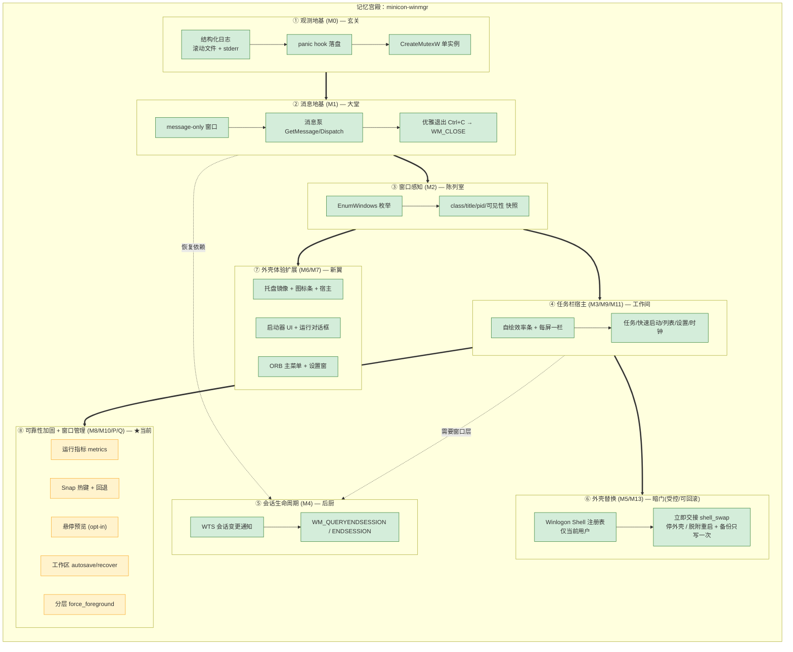

# minicon-winmgr — 产品需求文档（PRD）

> 版本：v1.2 · 更新：2026-10-13（发布 v0.1.1：任务栏二期 + 立即接管/归还 + 资源实测基线）
> 角色：**单一事实源（SSOT）**。此前分散的 `ui-ux.md` / `replacement-readiness.md` / `plan-*.md` 已并入本文与下方子文档。
> 读者：本仓后续会话 / 分身、评审者、产品与工程决策者。
> 用法：先读 [§0 方法学](#0-方法学这份-prd-怎么用)（含文档树 / 思维树 / 记忆宫殿三套工具的方法）；任何新想法**先回写本文件再动手**，否则视为漂移。

---

## 0. 方法学（这份 PRD 怎么用）

> 本章是**元规则**：定义本文档如何组织、如何演化，以及三件"思维工具"（文档树 / 思维树 / 记忆宫殿）各自的用法。
> 改 PRD 或改代码前，先读本章。

### 0.1 PRD 基本原则
1. **单一事实源（SSOT）**：本项目的一切"要做什么 / 为什么 / 到哪一步"只以本文档（及其子文档）为准；分散的旧文档一律并入，不再各处维护。
2. **反漂移**：任何新想法**先回写本 PRD（或对应子文档）再动手**；不在 PRD 里立项的功能视为漂移，不做。
3. **索引即文档树**：主文档保留**结构**（问题 / 目标 / 度量 / 功能树 / 思维树 / 记忆宫殿 / 里程碑 / 风险），只放摘要 + 指针。
4. **阈值拆分**：某树分支内容**超过一屏（约 40 行）**才切出独立子文档；低于阈值**内联**，避免碎片化——这是让 prd.md 保持"**有效索引系统**"而非"一堆空壳"的关键。
5. **命名 = 树路径**：子文档名 `prd_{idx1}_{idx2}.md`（可再向下 `_{idx3}`），索引 = 该枝在**树中的位置**（与章节号无关，故稳定；某枝再拆按 `_2`、`_3` 递增）。
6. **一处定义、他处引用**：跨文档用相对链接（如 [`prd_2_1.md`](prd_2_1.md) §3），不复制粘贴内容。
7. **文件路径用英文**，正文可用中文。

### 0.2 思维树方法学（markdown-tree-dag）
- **是什么**：把"如何达成根目标"拆成一棵有向无环图（DAG）——节点是**决策/能力**，边是**依赖**；一个节点可被多个父节点共享（用 `←`/并列标注额外父边）。见 [§5 思维树](#5-思维树markdown-tree-dag)。
- **怎么用**：① 新工作先在图里找**挂点**，没有挂点说明在漂移；② 定期**砍最高杠杆枝**（当前 ROI 最高的那一支往下深挖，其余暂缓）；③ 节点标注**状态**（✅/🟡/⬜）与**去向**（`→ prd_x_y.md` 表示该枝已超阈值、切到子文档）。
- **价值**：让"为什么现在做这个"有据可查，避免被局部需求牵着走。

### 0.3 记忆宫殿方法学（mermaid-flowchart-memory-palace）
- **是什么**：把系统想象成一座**宫殿**，每个房间=一个**关注点**（观测地基 / 消息地基 / 窗口感知 / 任务栏 / 会话 / 外壳替换 / 外壳体验 / 可靠性加固…），房间沿主廊排列。见 [§6 记忆宫殿](#6-记忆宫殿mermaid-flowchart-memory-palace)。
- **怎么用**：① **进场顺序 = 落地顺序**（先地基后上层），新模块先问"它属于哪个房间"；② 每个房间标注**里程碑**与**完成色**（绿=完成 / 黄=当前）；③ 作为"空间速记"，帮助快速回忆系统由哪些关注点构成、彼此如何相连。
- **价值**：与思维树互补——思维树答"做什么/为什么"，记忆宫殿答"系统长什么样/怎么连起来的"。

### 0.4 文档索引（按树的子路径切分）

```text
PRD 树（编号 = 子文档文件名里的索引）
1 外壳功能对齐
  1.1 功能明细与现状                      → prd_1_1.md
2 可靠性底座
  2.1 观测 · 稳定性 · 工作区自管 · 不变量   → prd_2_1.md
3 外壳替换与回滚
  3.1 门槛 · 流程 · 回滚                   → prd_3_1.md
4 设计语言
  4.1 视觉 tokens · 布局 · 交互            → prd_4_1.md
5 后续与调研
  5.1 缺口优先级 · 文件夹堆栈 · 可浏览桌面   → prd_5_1.md
6 任务栏交互策略
  6.1 合并 × 密度（拥挤自适应）             → prd_6_1.md
```

| 索引 | 子文档 | 内容 | 何时读 |
|------|--------|------|--------|
| 1.1 | [`prd_1_1.md`](prd_1_1.md) | 每一项外壳能力的现状、入口、实现文件、已知限制 | 做/改 UI 功能前 |
| 2.1 | [`prd_2_1.md`](prd_2_1.md) | 可观测、稳定性指标、会话生命周期、工作区自管、**不变量与坑** | **改代码前必读** |
| 3.1 | [`prd_3_1.md`](prd_3_1.md) | 替换门槛、切换/回滚流程、GUI 内入口 | 涉及 `Shell` 注册表时 |
| 4.1 | [`prd_4_1.md`](prd_4_1.md) | 视觉/交互规范（tokens、色板、布局、交互表） | 画界面时 |
| 5.1 | [`prd_5_1.md`](prd_5_1.md) | 未做项优先级、文件夹堆栈/可浏览桌面调研 | 规划下一步时 |
| 6.1 | [`prd_6_1.md`](prd_6_1.md) | **任务栏交互策略：窗口合并（三态）× 密度自适应（拥挤阶梯）、设置面板、配置持久化** | 改任务栏/设置时 |

**版本计划**（不属 PRD 树，按版本记录"这一版做什么"；需求仍需回写 PRD，不在 plan 里立项）：

| 版本 | 计划 / 记录 | 状态 |
|------|-------------|------|
| 0.1.1 | [`../CHANGELOG.md`](../CHANGELOG.md) | ✅ 已发布（tag `v0.1.1`） |
| 0.1.2 | [`../CHANGELOG.md`](../CHANGELOG.md) | ✅ 已发布（tag `v0.1.2`） |
| 0.1.3 | [`plan_0_1_3.md`](plan_0_1_3.md) | ⏳ 已排期（**托盘收敛 + 代码健康**；不新增产品功能） |
| 0.2.0 | [`plan_0_2_0.md`](plan_0_2_0.md) | ⏳ 待启动（P0-1/P0-2 已交付；P1-1 移交 0.1.3） |


---

## 1. 产品概述

### 1.1 问题
长时间运行的公司工作站会话里，**系统自带外壳（explorer）与第三方桌面外壳都可能卡死**，
表现为任务栏失去响应、桌面花屏、会话无法正常回收。现有外壳普遍缺少
**结构化可观测**与**可管理的会话生命周期**，出问题时只能靠重启会话解决。

### 1.2 愿景
提供一个 **可靠、可长期常驻、可管理** 的 Windows 外壳 / 会话管理器：
形态对齐成熟桌面外壳（任务栏、程序菜单、启动器…），但在
**稳定性、可观测、会话生命周期** 上做差异化加固，并能在需要时**受控地替代**系统外壳。

### 1.3 目标用户
- 长时间使用 Windows 工作站的公司用户（研发/运维/交易等常驻多窗口场景）。
- 需要统一管理桌面会话、又不能承受外壳崩溃的 IT 运维/管理员。

### 1.4 价值主张（差异化）
| 维度 | 系统/第三方外壳常见 | minicon-winmgr |
|------|--------------------|----------------|
| 稳定性 | 崩溃即不可用，缺自愈 | 常驻 + 指标采样 + 崩溃残留自恢复 |
| 可观测 | 基本无结构化日志 | 结构化日志/panic 落盘/周期指标 |
| 会话 | 会话生命周期不透明 | WTS 会话变更 + 结束事件显式处理 |
| 接管 | 只能整机替换 | **companion 优先**，替换可选、受控、可回滚 |
| 形态 | 图标 + 装饰 | **效率条**：图标锚点 + 文本、低噪声 |

---

## 2. 目标与非目标

**目标**
1. 稳定常驻：数小时无 panic / 句柄与 GDI 无泄漏 / 消息泵不卡死。
2. 可观测：结构化日志 + 指标，出问题可定位。
3. 外壳形态可用：任务栏为核心，逐步补齐菜单/启动器/通知区等。
4. 受控接管：默认 companion，不碰注册表；替换可一键回滚。

**非目标（当前阶段明确不做）**
- 打包发版、代码签名。
- 修改系统级 `Shell`（仅当前用户级、且需显式确认）。
- 动态桌面 / 壁纸 / 完整桌面图标体系的一次性铺开（属"后续与调研"）。

---

## 3. 成功度量
- **可靠性**：连续运行 ≥ 数小时，`handles`/`gdi_objects` 持平（`metrics` 日志佐证），无 panic。
- **资源**：常驻**私有字节 ≤ 20 MB**（2026-10-13 实测 14.5 MB，约为 explorer 的 1/4），详见 [`prd_2_1.md`](prd_2_1.md) §2。
- **可定位性**：任一异常都有结构化日志行；崩溃后残留（工作区等）能自恢复。
- **功能对齐**：任务栏/程序菜单/启动器等核心面达到"可日常使用"。
- **可回滚**：替换后任一路径都能一键恢复到原外壳。

---

## 4. 对标功能树（概览）

> 来源：对主流第三方 Windows 桌面外壳的公开功能梳理（不点名具体产品）。
> 状态图例：✅ 已实现 · 🟡 部分 · ⬜ 未做。逐项明细见 [`prd_1_1.md`](prd_1_1.md)。

```text
参考桌面外壳（Windows 外壳替代）
├── 任务栏 Taskbar
│   ├── 任务列表（每窗口一按钮，默认；可设 合并三态 + 依据）   ✅
│   ├── 列表按钮（窗口总览）                        ⛔ v0.1.2 退役
│   ├── 快速启动（recents 前 N 钉住）                           ✅
│   ├── 系统托盘 / 通知区                                      ✅ 镜像 + 图标条 / 宿主(替换模式)
│   ├── 时钟                                                  ✅
│   └── 设置入口                                              ✅ 真控件
├── 程序菜单 Programs Menu
│   ├── 应用列表 / 搜索                                        ✅
│   ├── Places（计算机/文档/下载…）                             ✅
│   ├── 最近使用                                              🟡（recents 已有，菜单内展示待做）
│   └── 拖拽整理分类                                          ⬜
├── 动态桌面 Dynamic Desktop
│   ├── 可浏览桌面                                            ⬜（调研见 prd_5_1.md）
│   └── 桌面图标                                              ⬜（不做 → 依赖系统桌面）
├── 文件夹堆栈 Folder Stacks                                  ⬜（调研：先做最小切片）
├── 窗口管理
│   ├── 悬停窗口预览                                          ✅（opt-in，默认关）
│   ├── 窗口贴靠 / Snap 热键                                  ✅（Win+* → Ctrl+Alt+* 回退）
│   └── 堆叠窗口组                                            ⬜
├── 多显示器支持（每屏一栏）                                   ✅
├── 个性化 / 主题（配置文件）                                  ✅
└── 外壳集成
    ├── 替换默认 shell                                        ✅（受控、可回滚）
    ├── 桌面/外壳模式切换                                     ✅（替换/回滚）
    └── 立即接管 / 立即归还（当前会话，无需注销）               ✅（见 prd_3_1.md §1b）
```

**对标结论**：形态价值集中在"任务栏 + 程序菜单 + 可浏览桌面"；我们的切入点是其下的
**可靠性底座与会话管理**——母题是"**默认 shell 与第三方外壳都可能卡死**"。

---

## 5. 思维树（markdown-tree-dag）

把"如何造一个可靠、可管理的桌面级外壳"拆成 DAG（节点可被多个父节点共享，用 `←` 标注额外父边）。

```text
[根] 让公司工作站获得可靠、可管理的 Windows 外壳
│    （`→ prd_x_y.md` 表示该枝内容已超过阈值、切到了对应子文档）
├── 可靠性底座 ★ 差异化护城河（已建成，持续加固）      → prd_2_1.md
│   ├── 可观测        → [A] 日志/panic ✅   [J] 运行指标 ✅
│   ├── 会话生命周期  → [E] WTS + 结束事件 ✅
│   ├── 崩溃自恢复    → [P] 工作区 autosave/recover ✅
│   └── 前台/焦点正确性 → [Q] force_foreground 分层置前 ✅
├── 外壳功能对齐                                      → prd_1_1.md
│   ├── 窗口可见性    → [C]✅ → [D] 任务栏 ✅ → [I] 每屏一栏 ✅
│   ├── 通知区        → [G] 镜像 ✅ → tray_bar ✅ / tray_host ✅
│   ├── 启动器        → [H] 检索+UI ✅ → 频次排序 [L] ✅
│   ├── 运行对话框    → [M] Win+R（回退 Ctrl+Alt+R）✅
│   ├── 主菜单        → [N] ORB：应用 + Places + 电源 ✅
│   ├── 任务栏增强    → [O] 快速启动 ✅ + 列表按钮 ⛔ + 设置入口 ✅
│   ├── 窗口管理      → [K] Snap 热键 ✅（含回退）
│   └── 设置          → [R] 设置窗（真控件）+ 替代/回滚 ✅
├── 任务栏交互策略                                    → prd_6_1.md
│   ├── 合并策略      → 三态（从不/已满/始终），默认从不 ✅
│   ├── 密度自适应    → D0 full ✅ → D1 compact ✅ → D2 icon-only ✅ → 溢出 ✅
│   └── 设置面板      → 合并/依据/显示 可交互控件 ✅
├── 设计语言                                          → prd_4_1.md
└── 部署安全 ✅
    ├── 默认不接管    → companion 模式（贯穿始终）
    ├── 可选替换      → [F] 受控 Shell 开关（可回滚）   → prd_3_1.md
    └── 立即交接      → [S] 接管/归还当前会话外壳 ✅（注册表 + 停/起外壳）  → prd_3_1.md §1b

依赖边（DAG）：
  A → B → C → D → F
  B → E ; C → J,K,L,M,N,O ; D → I,G,O,R ; C → P,Q
  D → 6.1（任务栏交互策略依赖任务栏宿主与窗口感知）
  F → S（立即交接依赖受控替换：先有备份与可回滚，才敢停外壳）

裁剪原则：可靠性底座是护城河、已就位并持续加固；当前 ROI 最高的剩余枝是
"外壳功能对齐的次级缺口"与"长跑稳定性观察"，见 prd_5_1.md；本轮排期见 plan_0_2_0.md。
```

---

## 6. 记忆宫殿（mermaid-flowchart-memory-palace）

把系统想象成一座宫殿，房间沿主廊排列；进门顺序即落地顺序（M0 → M11）。



> 图例：绿=已完成（M0–M13 全部完成）；黄=当前加固（可靠性 + 窗口管理，仍在持续观察）。

---

## 7. 需求与里程碑（状态）

| 里程碑 | 内容 | 状态 |
|--------|------|------|
| M0 | 常驻与可观测：日志双写、panic 落盘、单实例 | ✅ |
| M1 | 消息/窗口地基：message-only 窗口、消息泵、优雅退出 | ✅ |
| M2 | 窗口感知：顶层窗口枚举与快照 | ✅ |
| M3 | 任务栏宿主：自绘效率条（默认常显） | ✅ |
| M4 | 会话生命周期：WTS + 结束事件 | ✅ |
| M5 | 受控外壳开关：只读查询 + 二次确认写入 | ✅ |
| M6 | 壳面扩展：托盘镜像、启动器 UI、每屏一栏 | ✅ |
| M7 | 替代就绪：AppBar 停靠、tray_host、ORB 主菜单 | ✅ |
| M8 | 稳定性与输入：metrics、Snap 热键、recents | ✅ |
| M9 | 任务栏增强：快速启动、列表按钮（v0.1.2 退役）、热键回退 | ✅ |
| M10 | 悬停窗口预览（opt-in） | ✅ |
| M11 | 任务栏打磨：设置入口、每窗口一按钮、贴底锚定、工作区自管 | ✅ |
| M12 | 任务栏二期：密度三档（D2 仅图标）+ 悬停标题气泡 + 导航内数字快跳 + 分组批量菜单 + 窄栏折叠 + `»` 弹层分列 + 通知条开关 | ✅ |
| M13 | 立即接管 / 归还当前会话外壳（`shell_swap`）：备份只写一次、无记录拒绝归还、外壳脱附启动 | ✅ |
| P/Q | 崩溃自恢复（工作区 autosave/recover）、分层置前 | ✅ |

逐项明细、入口与已知限制见 [`prd_1_1.md`](prd_1_1.md)。

---

## 8. 风险与安全
- **漂移风险**：任何新点子先回写本文件（或子文档）再动手。
- **替换破坏性**：写 `HKCU\...\Winlogon\Shell` 属共享状态；**始终先备份、始终可回滚**，流程与门槛见 [`prd_3_1.md`](prd_3_1.md)。
- **多实例污染**：GUI 实验最多 1 个实例，用完即关并核对残留进程。
- **无 explorer 运行**：AppBar 停靠依赖 explorer 中转；无 explorer 时由我们自管工作区（见不变量）。

---

## 9. 不变量速查（改代码前必读）

> 完整清单与"已验证事实/坑"见 [`prd_2_1.md`](prd_2_1.md)。此处只列高频三条：

1. **taskbar 状态只允许消息线程访问**（`tasks/bars/tray_icons/pins`），**禁止新增 worker 线程抢这些锁**。
2. **文件/跨进程 IO 不得在持 `bars()`/`tasks()` 锁时做**（否则卡 UI）。
3. **激活/置前用 `win_util::force_foreground`**（分层兜底），不要裸调 `SetForegroundWindow`。
