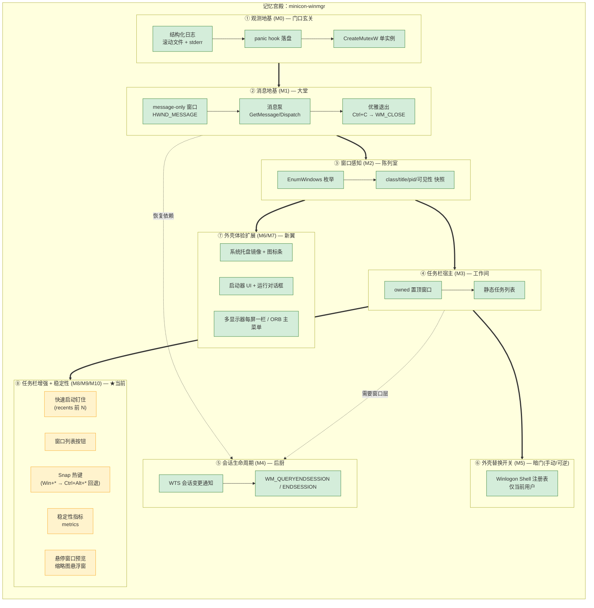

# minicon-winmgr — 产品需求文档（PRD）

> 状态：草案 v0.1（热身期）
> 目标读者：本仓后续会话 / 分身、评审者
> 关联：`README.md`（方向声明）、`docs/prd.md`（本文件）

---

## 1. 目的与范围

为公司工作站提供一个 **可靠、可长期常驻、可管理** 的 Windows 外壳 / 会话管理器，
对标成熟的第三方桌面外壳体验，但在 **稳定性与会话生命周期** 上做差异化加固。

- **范围内**：外壳常驻进程、窗口感知、任务栏宿主、会话生命周期、可选的外壳替换开关。
- **非目标（早期阶段明确不做）**：打包发布、代码签名、修改 Winlogon `Shell` 注册表（默认 companion 模式）、完整桌面/启动器 UI 的一次性铺开。

## 2. 设计原则（防漂移）

1. **companion 优先**：默认不接管、不修改系统注册表；替换 Explorer 仅作为可选、手动、可逆的后续步骤。
2. **可观测先行**：没有日志/告警的外壳不上线（对齐"日志做全"偏好）。
3. **小步验收**：每完成一小步即 `cargo check`，可运行即真跑一次并核对残留进程。
4. **按需求树裁剪**：任何新功能必须先落入第 6 节需求树，否则视为漂移。

---

## 3. 对标产品功能树 — 参考桌面外壳

来源：对主流第三方 Windows 桌面外壳的公开功能梳理（不针对具体产品命名）。

```text
参考桌面外壳（Windows 外壳替代）
├── 任务栏 Taskbar
│   ├── 任务列表（按应用/分类组织窗口）
│   ├── 列表按钮（窗口总览，便于切换）
│   ├── 系统托盘 / 通知区
│   ├── 时钟
│   └── 快速启动 / 任务栏快捷方式
├── 程序菜单 Programs Menu
│   ├── 应用分类（拖拽整理，用户自定义）
│   ├── 应用搜索
│   ├── Places（导航位置：计算机/文档等）
│   └── 最近使用
├── 动态桌面 Dynamic Desktop
│   ├── 可浏览桌面（无需打开资源管理器）
│   ├── 桌面图标
│   └── 弹出式前进 / 后退导航
├── 文件夹堆栈 Folder Stacks
│   └── 把常用文件夹拖到菜单栏做即时访问
├── 窗口管理
│   ├── 悬停窗口预览
│   ├── 堆叠窗口组（stacked window groups）
│   └── 窗口贴靠 / 靠边
├── 多显示器支持
├── 个性化 / 主题
└── 外壳集成
    ├── 替换默认 shell
    └── 桌面模式 / 外壳模式切换
```

**对标结论**：这类外壳的形态价值集中在"任务栏 + 程序菜单 + 可浏览桌面"。
我们的切入点是其下的 **可靠性底座与会话管理**——长时间公司桌面会话里，默认 shell 与第三方外壳都可能卡死。

---

## 4. 思维树（markdown-tree-dag）

把"如何造一个可靠、可管理的桌面级外壳"拆成 DAG：节点可被多个父节点共享（用 `←` 标注额外父边）。

```text
[根] 让公司工作站获得可靠、可管理的 Windows 外壳
├── 可靠性可观测硬化 ✅ 已砍完（M8）
│   ├── 运行指标      → [J] metrics ✅
│   ├── 崩溃可恢复    → [E] 会话生命周期 ✅
│   └── 日志 / panic  → [A] ✅
├── 外壳功能对齐 ★ 当前最高杠杆枝（正在砍）
│   ├── 窗口可见性    → [C] ✅ → [D] 任务栏 ✅ → [I] 每屏一栏 ✅
│   ├── 通知区        → [G] tray 镜像 ✅ → tray_bar 图标条 ✅ / 宿主 ✅
│   ├── 启动器        → [H] 检索 + UI ✅ → 频次排序 [L] ✅
│   ├── 运行对话框    → [M] Win+R（回退 Ctrl+Alt+R）✅
│   ├── 主菜单        → [N] ORB：应用 + Places + 电源 ✅
│   ├── 任务栏增强    → [O] 快速启动（recents 前 N 钉住）✅ + 列表按钮 ✅
│   └── 窗口管理      → [K] Snap 热键 ✅（含 Win+* → Ctrl+Alt+* 回退）
└── 部署安全 ✅
    ├── 默认不接管    → companion 模式（贯穿始终）
    └── 可选替换      → [F] 受控 Shell 开关（已试替换并还原）

依赖边（DAG）：
  A → B → C → D → F
  B → E
  C → J, K, L, M, N, O   （都建立在"窗口感知 + 任务栏"之上）
  D → I, G, O            （每屏一栏 / 通知区 / 快速启动都是任务栏的分区扩展）

裁剪原则：★ = 外壳功能对齐（[K–O]），因可靠性底座已就位、用户可感知的价值缺口在此；
剩余次级分支见 plan/plan-shell-gaps.md（悬停预览、文件夹堆栈、可浏览桌面）。
```

---

## 5. 记忆宫殿（mermaid-flowchart-memory-palace）

把整个系统想象成一座"宫殿"：四个房间沿主廊排列。每个房间是一个关注点，
进门顺序即落地顺序（M0 → M5）。



> 图例：绿=已完成（M0–M7）；黄=当前推进（M8/M9：任务栏增强 + 稳定性指标）。
> 剩余次级项（悬停预览 / 文件夹堆栈 / 可浏览桌面）见 `plan/plan-shell-gaps.md`。

### 5.1 已验证事实与坑（不变量）

> 由"政委"审阅 + 实测确认，跨会话沿用。改代码前先读这一节。

**已验证事实**
- `cargo test` = 91 passed；`cargo clippy --all-targets -- -D warnings` 干净；`cargo fmt --check` 通过。
- companion 模式下默认外壳常占用 `Win+*`：`run_dialog` 与 `hotkeys` 均**回退**到 `Ctrl+Alt+*`（实测注册成功）。若回退也被占，仅记 `error` 日志、热键不可用（用户无感）。
- companion 模式下系统通知区被其它外壳接管，`tray` 镜像常为 `count=0`；替换模式才由 `tray_host` 提供。
- 稳定性：句柄/GDI 在分钟级测量中**持平**（无泄漏）；AppBar `ABM_NEW` 在已有外壳占底边时失败 → 退化为悬浮（预期 WARN）。

**坑 / 不变量**
- **taskbar 状态只允许消息线程访问**：`tasks()` / `bars()` / `tray_icons()` / `pins()` 共用唯一消息线程。当前加锁顺序**不统一**（`paint` 是 tasks→bars→pins，`refresh` 是 bars→tasks），仅因单线程才安全；**任何新增 worker 线程都可能死锁**。禁止新增线程去抢这些锁。
- **文件/跨进程 IO 不得在持 `bars()`/`tasks()` 锁时做**：`refresh()` 会同步跨进程读托盘 + 扫开始菜单，周期过长会卡 UI；新功能把 IO 放锁外。
- **激活窗口前必须 `IsWindow` 守卫**：句柄可能已关闭并被复用，否则会把前台切到错误窗口（`taskbar::activate` 已加）。
- **悬停预览禁止在 `WM_MOUSEMOVE` 同步 `PrintWindow`**：用 `WM_TIMER` 节流（350ms），单窗口 show/hide 复用，`HBITMAP` 在 target 变化与 `WM_DESTROY` 时释放（`hover_preview`）。
- **不改 `Cargo.toml` 的 feature 冻结约定**：禁止用 `windows::core::link!` 绕过未启用 feature，改用语义化 feature（如 `PrintWindow` 需 `Win32_Storage_Xps`）。
- **AppBar 由 explorer 中转**：`SHAppBarMessage(ABM_NEW)` 需要 explorer 在场做 AppBar broker；explorer 不在（或被杀）时注册失败。因此：① 任务栏定位使用**显示器物理边界 `rcMonitor`**（`monitor::MonitorInfo::bounds`），悬浮时也贴底；② AppBar 失败时**由我们自己 `SPI_SETWORKAREA` 收窄工作区**（保留底边 BAR_H），并在 `WM_DESTROY`（最后一栏销毁）时 `restore_workarea` 还原。→ 无 explorer 也能让最大化窗口不压栏（readiness 门槛 #2）。
  - 风险：若进程**崩溃**（非正常退出）不会走 `WM_DESTROY`，工作区会保持收窄（表现为下方留一条空带）。恢复：重启 shell 或手动还原工作区。
- **任务栏默认每窗口一个按钮**（对齐 Alt+Tab），按 pid 分组是 opt-in：`MINICON_GROUP_TASKS=1`。分组会把同进程多窗口折成 `(+N)`，曾被用户报"任务栏漏窗"。
- **悬停预览默认关闭**：`MINICON_HOVER_PREVIEW=1` 才启用（用户判定该功能价值低）。
- **前台锁坑**：任务栏/设置等是 top-most tool window，直接 `SetForegroundWindow` 常被系统前台锁拒绝（点了拉不起来）。统一用 `win_util::force_foreground`：先 `AttachThreadInput` 挂到当前前台线程再 `SetForegroundWindow`，之后脱开。
- **显隐状态用真实查询**：`settings_ui::toggle` 不能缓存在内存标志里（切走后标志与真实可见性会不一致），改用 `IsWindowVisible` + `GetForegroundWindow`：可见但非前台 → 置前；可见且前台 → 隐藏。
- **设置窗口含"替代/回滚"**：`do_replace` 先把当前 `Shell` 值备份到 exe 同目录 `shell-backup.txt` 再 `replace`；`do_rollback` 读该备份 `restore(Some)`，无备份则 `restore(None)`（回 explorer），且以 MessageBox 二次确认（默认"否"）。

---

## 6. 最小核心需求树（MVP）

| 编号 | 需求 | 验收标准 | 里程碑 | 状态 |
|------|------|----------|--------|------|
| A | 常驻与可观测 | 滚动文件+stderr 双写；panic 入日志；二次启动被拒 | M0 | ✅ 已实现 |
| B | 消息 / 窗口地基 | message-only 窗口可建；消息泵稳定运行；Ctrl+C 优雅退出 | M1 | ✅ 已实现 |
| C | 窗口感知 | 枚举顶层窗口并可输出 class/title/pid/可见性快照 | M2 | ✅ 已实现 |
| D | 任务栏宿主 | 自建置顶窗口，静态展示 C 的快照 | M3 | ✅ 已实现（默认常显） |
| E | 会话生命周期 | 收 WTS 会话变更 + `WM_QUERYENDSESSION/ENDSESSION`，记录回收路径 | M4 | ✅ 已实现 |
| F | 外壳替换开关 | 当前用户级、手动、可一键回滚 | M5 | ✅ 已实现（受控；写入需二次确认） |

**差异化定位**：A/B/E 是我们的护城河（可靠性 + 会话管理）；C/D 是"像成熟外壳"的最低门槛。

---

## 7. 里程碑与风险

- **M0 / M1 已完成**（companion 模式，未触碰任何注册表；未发版、未签名）。
- **风险 1 — 漂移**：任何新点子先回写第 4/6 节再动手。
- **风险 2 — 会话替换的破坏性**：M5 修改 `HKCU\...\Winlogon\Shell`，属共享系统状态，落地前需人工确认并提供回滚。
- **风险 3 — 多实例污染**：GUI 实验最多起 1 个实例，用完即关并核对残留进程。

## 8. 后续待办（Followups）

- [x] M2：`EnumWindows` 顶层窗口枚举与快照日志
- [x] M3：任务栏宿主窗口（默认常显；`MINICON_NO_TASKBAR=1` 隐藏）
- [x] M4：WTS 会话变更通知 + 会话结束处理
- [x] M5：受控的 Winlogon Shell 开关。`--shell-status` / `--shell-list` 只读；写入（`--shell-set` / `--shell-replace` / `--shell-rollback`）需 `MINICON_CONFIRM_SHELL=yes` 二次确认。
- [x] M3+：自绘任务栏（极简深色、文本优先、hover/active、点击切窗、时钟+计数；过滤 helper 窗口 903→11）。设计语言见 `docs/ui-ux.md`。
- [x] DWM 圆角（默认）+ 亚克力（`MINICON_ACRYLIC=1`，opt-in），均优雅降级（`src/dwm.rs`）。
- [x] 键盘导航：Alt+` 唤出、←/→ 选择、Enter 切换、Esc 取消（含单元测试）。
- [x] 任务分组（按 pid 折叠，`src/grouping.rs`）；config/主题（`src/config.rs`）；多显示器枚举（`src/monitor.rs`，**每屏一栏**由 `src/taskbar.rs` 落地）；开始菜单检索（`src/launcher.rs`，`--launch` CLI）；CI 基线（`.github/workflows/ci.yml`）。
- [x] 系统托盘镜像（`src/tray.rs`，companion 模式读现有 shell 托盘；当第三方外壳接管时无 `Shell_TrayWnd` 可读，返回 0）、应用启动器 UI（`src/launcher_ui.rs`，Alt+Space 弹窗）。
- [ ] 继续对齐外部外壳实现：**AppBar 停靠已实现**（已有外壳占边时 `ABM_NEW` 可能失败→退化为悬浮）；随后 Snap/多屏热键。
- [x] M7 替代就绪：AppBar 停靠、`tray_host`（替换模式托盘宿主）、`start_menu`（ORB）。门槛见 `docs/replacement-readiness.md`。
- [x] M8 稳定性 + 输入：`metrics`（内存/句柄/GDI 周期采样）、`hotkeys`（Win+←/→/↑ Snap）、`recents`（启动频次排序）。
- [x] 运行对话框 `run_dialog`（Win+R，被占用时回退 Ctrl+Alt+R）；托盘图标条 `tray_bar`（任务栏右区绘制，companion 下无图标则不占位）。
- [x] M9 任务栏增强：快速启动 `quick_launch`（把 recents 前 N 名钉到任务栏左侧，无历史则空）、窗口列表按钮 `task_list`（点击弹出全部分组窗口的菜单）；Snap 热键加 `Win+* → Ctrl+Alt+*` 回退。
- [x] M10 悬停预览：`hover_preview`（任务栏按钮悬停 350ms 弹 `PrintWindow(PW_RENDERFULLCONTENT)` 缩略图；纯几何 `target_rect` + 单测；单窗口复用、位图按需释放）。
- [x] 调研：文件夹堆栈 / 可浏览桌面 → `plan/plan-folder-stacks.md`（结论：先做"文件夹堆栈最小切片"，可浏览桌面缓做）。
- [x] M11 任务栏打磨：**设置按钮**（最左，点开 `settings_ui` 占位对话框，5 行）；任务按钮**默认每窗口一个**（`MINICON_GROUP_TASKS=1` 才按 pid 分组）；栏改用**显示器物理边界**贴底（AppBar 失败时也不悬空）。
- [ ] 外壳功能补全（次级，见 `plan/plan-shell-gaps.md`）：文件夹堆栈最小切片、主菜单最近使用/搜索、可浏览桌面。
