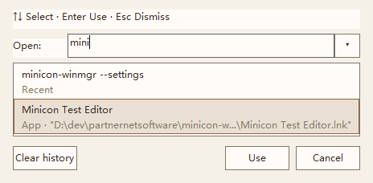
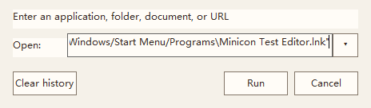

# minicon-winmgr

[Language index](readme.md) · **English** · [简体中文](readme.zh.md)

**Stability first. A minimal footprint.**

A lightweight Windows desktop shell built with Rust and Win32, designed as a replacement for the system desktop shell. Stability, memory safety, and low memory use guide the design: everyday actions stay direct, and optional capabilities are enabled when needed. The current default is companion mode; replacing the desktop shell requires explicit takeover.

## Why minicon-winmgr

- **Stability at the core.** Rust's ownership and type systems reduce memory-error risks, with explicit handle and resource-lifetime management at Win32 boundaries. Failed settings saves preserve the original file and support retries; shutdown restores the work area. Full release regression checks provide reproducible evidence of reliability.
- **Low resident memory use.** Native Rust and Win32, without an embedded browser engine. A local v0.1.7 release sample across 40 theme/position switches measured approximately **13.5–13.9 MiB of private bytes** and **36 MiB of working set**. See the [measurements and scope](docs/acceptance_release_0_1_7.json). These are short-run, scenario-specific results; a long-term memory study is tentatively planned for 0.1.10.
- **Minimal by default, optional by choice.** Everyday paths stay focused on the taskbar and settings. Thumbnail previews are off by default and do not create a preview window; companion mode leaves Explorer's notification host in place. Optional capabilities remain a user choice, keeping extra controls and default overhead down.

Product principle: **Optional features you do not need should not load by default.** In 0.1.8, the legacy menu is not initialized by default, previews do not create a window until enabled, and Run creates its window and workers on first use. The notification host initializes according to shell identity and explicit configuration. See the [0.1.8 design and acceptance](docs/plan_0_1_8.md).


Current release: **[0.1.8](https://github.com/partnernetsoftware/minicon-winmgr/releases/tag/v0.1.8)**. See the [changelog](CHANGELOG.md), [product requirements](docs/prd.md), and [implementation plan](docs/plan_0_1_8.md). Linked design and specification documents are currently primarily in Chinese.

Version 0.1.8 adds on-demand initialization, taskbar Home/End and Space navigation, Esc to return to the previous window, and explicit Use/Run feedback for candidates. It retains compact settings, English/Chinese UI with English as the default, Light/Dark/Auto themes, and taskbar docking on all four edges. Desktop management stays collapsed, and configuration details can be selected and copied. If the process is already elevated, it restarts as the same user in the same session with standard privileges. Ordinary launches continue directly; the application does not request UAC elevation. See the [release acceptance record](docs/acceptance_release_0_1_8.json) for validation and coverage limits.

## Settings preview

Actual native Win32 windows, captured from 0.1.8. Language changes apply immediately and are saved. Auto theme follows the Windows application theme.

| English · Light | English · Dark |
|---|---|
|  |  |

| Chinese · Light | Chinese · Dark |
|---|---|
|  |  |

Screenshots render only this application's windows.

Run updates suggestions as you type and separates adopting a candidate from executing a command (actual windows with an isolated demo configuration):

| Select a candidate / Use | Edit after adoption / Run |
|---|---|
|  |  |
 See the [UI design](docs/design_0_1_6_industrial.md) and [test layers](docs/testing.md).

## Capabilities

- Taskbars on multiple monitors; window activation/minimization; grouping by application or process; adaptive density and overflow menus; pinned shortcuts and folder entries.
- Alt+Space launcher and Win+R Run dialog, with Ctrl+Alt+R as the registration fallback. Run supports history, path suggestions, Chinese IME, and launch-error feedback.
- Real notification icons in replacement mode, versioned callbacks, a paged hidden-icon panel, and application re-registration recovery. Companion mode retains Explorer's notification host without drawing inert application placeholders.
- Session cleanup, logs and resource metrics, work-area reservation/restoration, and explicit shell takeover and rollback.

Settings is the remaining entry on the leading side of the taskbar. The start-menu dot and window-list button were retired in 0.1.2; the legacy menu remains behind a hidden switch. Sound/network entries open system settings; power/input-method status icons are not implemented. Settings uses native controls with keyboard navigation, scrolling, configuration-source information, and save retries.

## Download

Download the Windows x64 executable and `SHA256SUMS.txt` from [GitHub Releases](https://github.com/partnernetsoftware/minicon-winmgr/releases/latest). Normal use does not require administrator privileges. Exit the old instance normally before upgrading, and retain your personal configuration. Binaries are not yet code-signed.

## Build, use, and configure

```powershell
cargo build
New-Item -ItemType Directory -Force .\target\debug\live | Out-Null
Copy-Item .\target\debug\minicon-winmgr.exe .\target\debug\live\minicon-winmgr.exe
.\target\debug\live\minicon-winmgr.exe
```

If an instance is running, `minicon-winmgr.exe --settings` opens its settings window. This also works with the taskbar disabled. During development, build first, exit the old instance, then copy and run the live executable to avoid locking Cargo's build artifacts.

Click the clock to open the notification panel, which includes Date & time settings. Double-click the clock to open those system settings directly.

Alt+backtick focuses the taskbar; use arrow keys to select, Home/End to reach either end, Enter/Space to activate, and Esc to return to the previous window. Win+B opens the notification panel, supporting arrow keys, Home/End, Tab, Enter/Space, Shift+F10, and Esc. Window snapping uses Win+arrow, with Ctrl+Alt+arrow as the fallback when registration conflicts. Actual hotkey registration results are currently recorded mainly in logs.

Configuration precedence: environment variables > `minicon-settings.txt` beside the executable > `minicon.conf` > defaults. `MINICON_CONFIG` and `MINICON_SETTINGS` override file paths. Settings writes are asynchronous, update individual keys, and create backups. Failed saves preserve the original file, display status, and can be retried; unrelated handwritten configuration is retained. Valid environment overrides are read-only in settings, with a short fixed-setting hint. Technical source details are available in Configuration & About. The authoritative key table is maintained in the [taskbar and configuration specification](docs/prd_6_1.md).

Taskbar visibility changes the next-start preference; the panel also reports the current state. Hover previews can be toggled at runtime. Run expands defined `%VARIABLE%` references in both targets and arguments, preserves unknown variables, and suggests specifying an editor when a file's default application is unavailable.

Shell takeover immediately closes the current session's desktop shell and changes the current user's shell for subsequent logins. Read the [takeover and rollback specification](docs/prd_3_1.md) first, and retain rollback records. Command-line changes require explicit `MINICON_CONFIRM_SHELL=yes`; settings retains a confirmation with No as the default. Ordinary development does not require takeover.

## Development and documentation

- [Code and documentation map](docs/code-map.md): module boundaries, gaps, and evidence.
- [Implementation plan](docs/plan_0_1_6.md): settings usability and feedback, including the 0.1.7 release follow-up.
- [0.1.8 design and delivery](docs/plan_0_1_8.md): on-demand startup and daily interactions.
- [0.1.9 update design](docs/plan_0_1_9.md): Check / Update / Restart.
- [Future capabilities](docs/prd_5_1.md): unscheduled requirements and prerequisites.
- [Archive](docs/archive/README.md): historical plans, roadmaps, and documentation.

Use `python scripts/test.py` for quick development checks. `--layer unit --filter config::tests` runs one test module; `--layer appearance` or `--layer settings` runs the corresponding desktop checks. Before a release, `--layer release` runs the full automated suite against an optimized build. See [test layers](docs/testing.md) for scope and environment requirements. Release validation builds in `target/release-validation` to avoid locks from older instances. Windows CI runs static `quality` checks; the release workflow additionally runs all unit tests and builds tagged releases. Code signing is not included. For custom toolchain locations, set `RUSTUP_HOME`/`CARGO_HOME` and add Cargo's bin directory to PATH.

See the [0.1.8 release acceptance record](docs/acceptance_release_0_1_8.json). Historical 0.1.6 evidence remains in its [plan](docs/plan_0_1_6.md) and [acceptance data](docs/acceptance_0_1_6.json). Physical mixed-DPI monitors, monitor hot-plugging, screen-reader speech, high-contrast display, and hour-long stability remain outside the current coverage.
