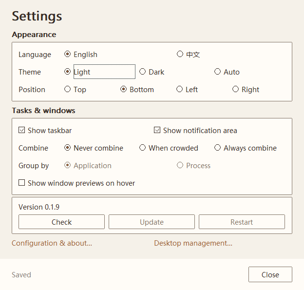
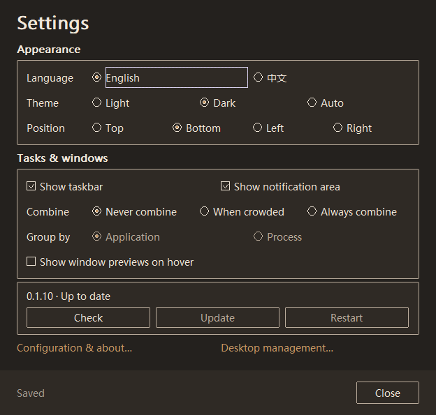
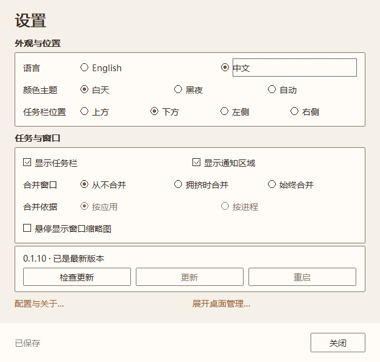
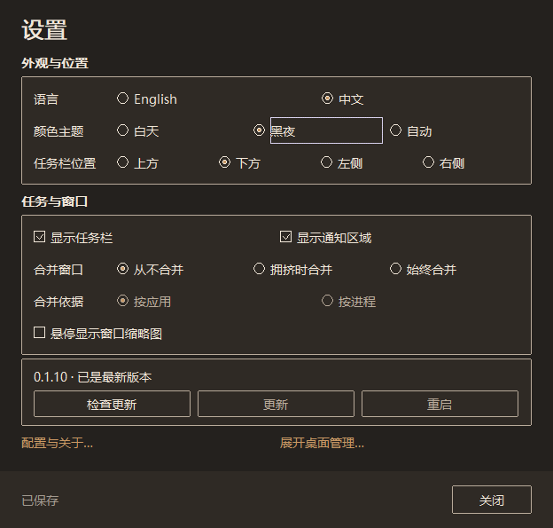

# minicon-winmgr

[语言索引](readme.md) · [English](readme.en.md) · **简体中文**

**稳定优先，简约常驻。**

为稳定常驻而设计的轻量 Windows 桌面外壳，使用 Rust + Win32 构建。以替代系统桌面外壳为目标，把稳定性、内存安全和低内存占用放在核心位置，让常用操作保持直接，可选能力按需启用。当前默认采用共存模式，替换桌面外壳需显式接管。

## 为什么选择 minicon-winmgr

- **稳定是核心。** Rust 的所有权与类型系统降低内存错误风险，Win32 边界显式管理句柄和资源生命周期。设置保存保留原文件并支持重试，退出恢复工作区；发布前执行完整 release 回归。内存安全是工程基础，稳定性用可复现的验证记录持续证明。
- **原生轻量底座。** Rust + Win32，不嵌入浏览器内核，可选功能按需初始化。0.1.10 已加入有界资源管理与按需诊断，[实测记录](docs/validation_0_1_10.md)注明具体场景；长期观察独立跟踪。
- **简约，按需启用。** 保留任务栏与设置等日常主路径，缩略预览默认关闭且不创建预览窗口；伴随模式不接管 Explorer 的通知宿主。可选能力由用户选择，减少多余入口与默认开销。

产品原则：**用不上的可选功能，默认不加载。** 0.1.8 中，旧菜单默认不初始化，缩略预览默认不创建窗口，Run 的窗口和工作线程首次使用时才创建；通知宿主按外壳身份和显式配置决定初始化。详见 [0.1.8 设计与验收](docs/archive/plan_0_1_8.md)。


当前版本 **[0.1.11](https://github.com/partnernetsoftware/minicon-winmgr/releases/tag/v0.1.11)**。版本事实见 [发布说明](docs/releases/v0.1.11.md)，需求入口见 [PRD](docs/prd.md)，本版范围与验收见 [0.1.11 计划](docs/plan_0_1_11.md)。

0.1.11 加固普通权限启动，时钟改为 `Www yyyy-mm-dd HH:MM`，Run 上下选择候选时同步预览到输入框。0.1.10 会记住你的布局，左右侧栏可拖宽，点击时间可打开回收站，换版本启动前会先询问。修复任务条换到侧边后最大化窗口底部留空。保留手动检查/更新/重启、默认英文的中英界面、白天/黑夜/自动主题与按需功能；检测到自身提升权限后以同用户普通权限重新启动，不主动请求 UAC。实测与覆盖限制见 [0.1.10 验收](docs/validation_0_1_10.md)。

## 设置预览

真实 Win32 设置窗口截图，截图来自 0.1.10。默认 **English**，可在设置中即时切换 **中文**并保存；提供白天、黑夜和跟随 Windows 的自动主题。

| English · Light | English · Dark |
|---|---|
|  |  |

| 中文 · 白天 | 中文 · 黑夜 |
|---|---|
|  |  |

截图直接渲染本应用窗口，没有桌面内容。

设计说明见[界面设计](docs/design.md)，验证方法见[测试分层](docs/testing.md)。

## 当前能力

- 多屏任务栏、窗口激活/最小化、按应用或进程合并、拥挤密度调整和溢出菜单、快捷启动与文件夹入口。
- Alt+Space 启动器；Win+R 运行框（注册失败时 Ctrl+Alt+R），支持历史、路径建议、中文 IME 与启动失败反馈。
- 替换模式的真实通知图标、版本化回调、分页隐藏图标面板与应用重注册恢复。伴随模式保留 Explorer 通知宿主，不绘制不可点击的应用占位。
- 会话回收、日志和资源指标、工作区预留/恢复、显式接管与回滚。

任务栏左侧保留设置入口。开始菜单圆点与窗口列表按钮已于 0.1.2 退役；旧菜单仅保留隐藏开关，不列为默认主路径。声音/网络入口是设置快捷方式，电源/输入法状态图标尚未实现。设置面板使用原生控件，支持键盘导航、滚动、来源说明和保存失败重试。

## 下载

从 [GitHub Releases](https://github.com/partnernetsoftware/minicon-winmgr/releases/latest) 下载 Windows x64 可执行文件与 `SHA256SUMS.txt`。普通运行无需管理员权限；请保留个人配置；启动不同构建时会先询问是否替换正在运行的实例。二进制尚未代码签名。

## 在设置中更新

按 **检查更新 → 更新 → 重启** 操作。检查由用户点击触发，启动程序、打开设置都不会访问更新服务。更新会下载并校验正式 Windows x64 版本，当前程序继续运行；下载验证完成、设置保存后才启用“重启”。只重启 winmgr，其他应用继续保留。

程序所在目录需允许当前普通用户写入。目录只读时，请下载发布文件并手动替换；更新过程不请求 UAC。临时助手等待旧实例正常退出，再保留备份、替换文件并核对新版启动回执；文件占用或启动失败时，在文件系统允许的情况下恢复旧版。

暂存及备份位于程序旁的 `.winmgr-update-*` 目录。确认新版工作正常后，可手动删除旧的已完成备份目录；普通启动不扫描这些目录，也不会自动恢复待安装更新。技术失败详情保留在“配置与关于”和日志中。

## 使用与配置

```powershell
cargo build
New-Item -ItemType Directory -Force .\target\debug\live | Out-Null
Copy-Item .\target\debug\minicon-winmgr.exe .\target\debug\live\minicon-winmgr.exe
.\target\debug\live\minicon-winmgr.exe
```

已有实例时运行 `minicon-winmgr.exe --settings` 可再次呼出设置；无任务栏时该入口仍可用。开发时先构建，再退出旧实例、复制到 live 运行，避免锁住构建产物。

单击时间打开通知面板，面板含“时间设置”；双击时间直接打开同一系统日期/时间设置。

Alt+反引号聚焦任务栏，方向键选择、Home/End 到首尾、Enter/Space 激活、Esc 返回原窗口；Win+B 打开通知面板，支持方向键、Home/End、Tab、Enter/Space、Shift+F10、Esc。窗口贴靠使用 Win+方向键，冲突时有 Ctrl+Alt+方向键回退；实际注册结果目前主要写入日志。

偏好自动保存到 `~/winmgr.cnf`（`%USERPROFILE%\winmgr.cnf`），无参数启动即可恢复。任务栏在左/右侧时，拖动朝向桌面的边缘即可调宽，宽度也会保存。新文件不存在时兼容读取程序旁的旧 `minicon-settings.txt`，首次成功保存时迁入新文件，旧文件保留。配置优先级：环境变量 > `winmgr.cnf` > `minicon.conf` > 默认值。`MINICON_CONFIG` / `MINICON_SETTINGS` 可指定路径；设置文件异步按键更新并备份，失败保留原文件、显示状态并可重试，手写配置不被重写。有效环境覆盖项在面板中只读，仅显示简短的固定提示；技术来源可在“配置与关于”中查看。完整键表只维护在 [任务栏与配置规格 §6](docs/prd_6_1.md)。显示任务栏只修改下次启动偏好，面板同时显示当前状态；悬停预览支持运行时开关。Run 的目标和参数均展开已定义的 `%变量%`，未知变量保留；默认打开程序失效时提示指定编辑器。

接管会立即关闭当前会话的桌面外壳，并修改当前用户的后续登录 Shell。先读 [接管与回滚规格](docs/prd_3_1.md)，保留回滚记录；命令行修改需显式 `MINICON_CONFIRM_SHELL=yes`，设置面板保留默认“否”的确认。普通开发无需接管桌面。

## 开发与文档

- [代码与文档地图](docs/code-map.md)：模块边界、已知差距和证据入口。
- [0.1.6 计划](docs/archive/plan_0_1_6.md)：设置日常可用与反馈闭环。
- [0.1.8 设计与交付](docs/archive/plan_0_1_8.md)：按需启动与日常交互。
- [0.1.9 更新功能设计](docs/plan_0_1_9.md)：Check / Update / Restart。
- [后续能力清单](docs/prd_5_1.md)：未排期需求及实施前提。
- [历史归档](docs/archive/README.md)：旧版本计划、旧路线图和整理前 README。

开发期使用 `python scripts/test.py` 快速检查；`--layer unit --filter config::tests` 只跑指定模块，`--layer appearance --restore-exe <normal-running-exe>` / `settings --restore-exe <normal-running-exe>` 在隔离副本中运行对应桌面专项；可加 `--candidate-exe <existing-exe>` 复用已有构建。准备发布时用 `--layer release` 跑全部自动化，并测试 release 产物。分层内容与环境要求见[测试说明](docs/testing.md)。Windows CI 执行 `quality` 与有界 `fault` 检查；手动触发 candidate workflow 跑优化单元并构建待验收文件。打 tag 时复核构建身份，把同一份已测文件晋升为草稿；证据和截图审阅后再公开，代码签名尚未纳入。构建工具链如在自定义位置，设置对应 `RUSTUP_HOME` / `CARGO_HOME` 并把 Cargo bin 加入 PATH。

发布验收见 [完整发布记录](docs/validation.md)，本版详见 [0.1.10 验收](docs/validation_0_1_10.md)；0.1.6 的历史自动化与桌面证据见 [版本计划](docs/archive/plan_0_1_6.md) 和 [验收数据](docs/validation.md)。物理混合 DPI、多屏热插拔、屏幕阅读器语音、高对比度和小时级长跑未覆盖。
